

.. |newpage| raw:: latex

   \newpage

.. |br| raw:: html

    

|newpage|

Bessel functions
===============================================================================

Bessel function of the 1st kind, `J_{\nu}(x)`
---------------------------------------------------------------------------------

.. method:: ctx.bessel_jv(nu, x, scaled=False)

    Returns `J_{\nu}(x)`, the Bessel function of the 1st kind. 

    If *scaled* is *True*, then `J_{\nu}(x) \cdot \exp(-|\Im(x)|)` is returned, which means that for purely  real `x` just `J_{\nu}(x)` is returned.  

    See also  Wikipedia :cite:p:`WikipediaFun84`,  MathWorld :cite:p:`WolframFun84`, NIST :cite:p:`DLMFun84`, BoostMath :cite:p:`BoostFun84`, :cite:t:`Ehrhardt2018` (3.1.3.1), Flint :cite:p:`FlintFun84`, Flint :cite:p:`FlintFun85`, Mpmath :cite:p:`MpmathFun84`.

    If ``ctx`` is ``math53``, ``ctxboost`` or ``ctxflintreal``, then `\nu, x \in \mathbb{R}` is exspected. If ``ctx`` is ``cmath53``, then `\nu \in \mathbb{R}` and `x \in \mathbb{C}` is exspected.  If ``ctx`` is ``ctxflintcplx`` then `\nu, x \in \mathbb{C}` is accepted. 

    The function is defined as

    .. math:: J_{\nu}(x)  = \left(\tfrac{1}{2}x\right)^{\nu}  \sum_{k=0}^\infty (-1)^k \frac{(x^2 / 4)^k}{k! \Gamma(\nu+k+1)} = \frac{1}{\Gamma(\nu+1)} \left(\frac{z}{2}\right)^{\nu} {}_0F_1\left(\nu+1, -\frac{z^2}{4}\right).

    The :ref:`wpf figures <rst_wpf_complex_function>` below are showing the real part (left figure), imaginary part (middle figure) and absolute value with color-coded phase (right figure) of the complex function `z = J_{\nu}(x + iy)` with `\nu=0` and  `-6 \le x \le 6` (blue axis), `-6 \le y \le 6` (red axis), `-10 \le z \le 10` (green axis). Function values are :ref:`loglog-transformed <rst_mpm_loglog_transformation>`.

|06a_TestBesselJ0_re| `\quad` |06b_TestBesselJ0_im| `\quad` |06c_TestBesselJ0_abs|

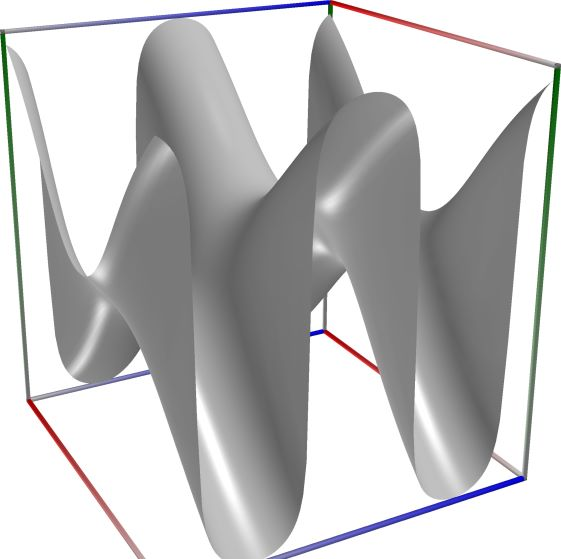

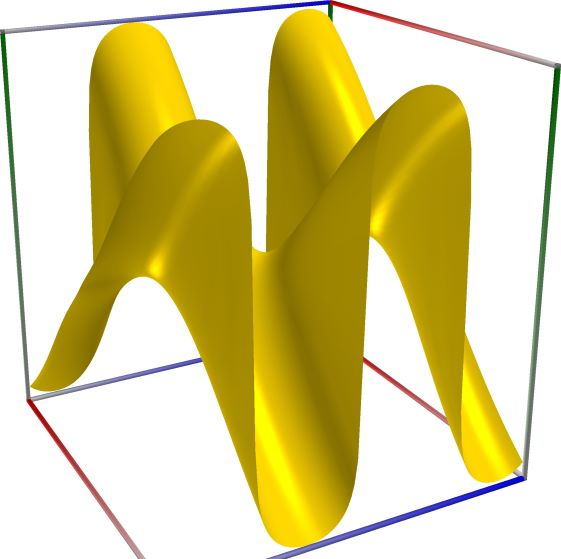

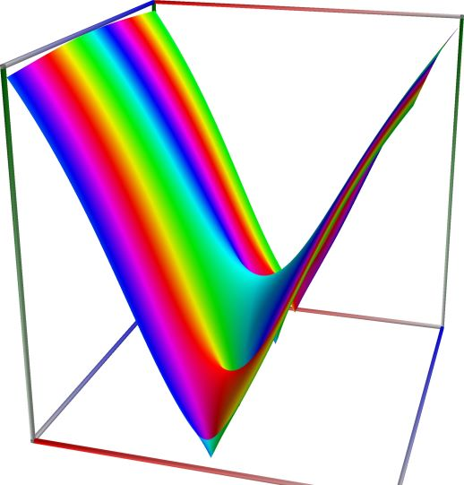

The corresponding scaled function looks like this:

|07a_TestBesselJ0e_re| `\quad` |07b_TestBesselJ0e_im| `\quad` |07c_TestBesselJ0e_abs|

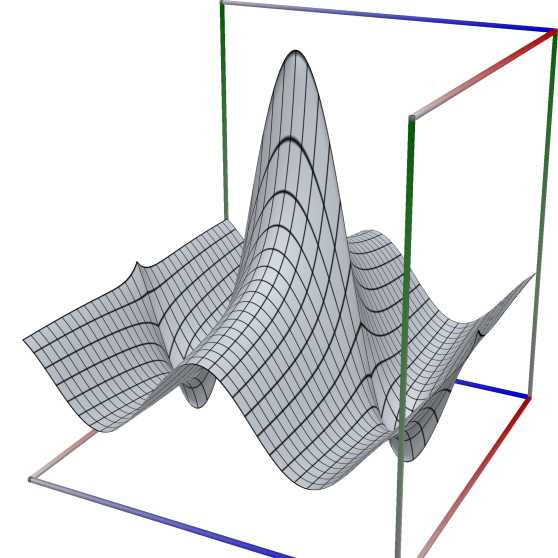

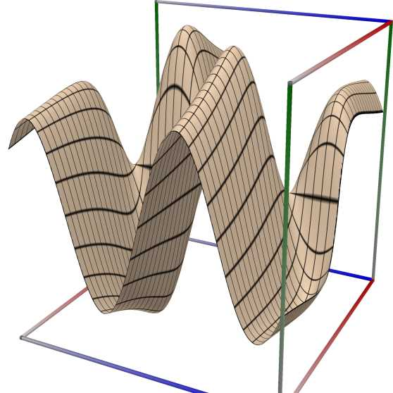

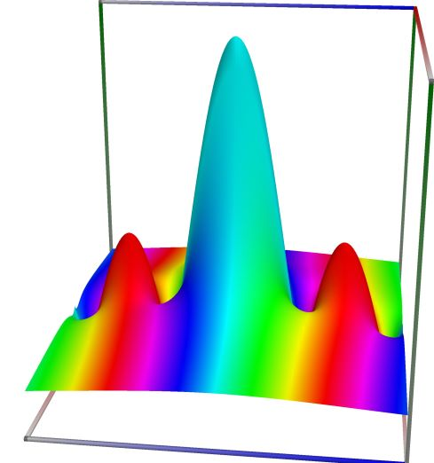

An example with real input:

.. code-block:: pycon

    >>> from xlcalcnet import *
    >>> nu = 5.1; x = 2.7; gui.setdps(90)
    >>> for ctx in gui.ctxlist_noipm_real: print(ctx.fmtname + ': ' + ctx.fmt(ctx.bessel_jv(nu, x, scaled=False)))
        fpm:  0.0239004453102261
        mpm:  0.0239004453102260778171824118128476464469622918920344159656763293905516361558164568383299914
        dpm:  0.0239004453102260778171824118128476464469622918920344159656763293905516361558164568383299914
        gpm:  0.023900445310226077817182411812847646446962291892034415965676329390551636155816456838329991402
        apm: [0.02390044531022607781718241181284764644696229189203441596567632939055163615581645683832999 +/- 2.43e-90]
     math53:  0.0239004453102261
      sreal:  0.02390045
      dreal:  0.0239004453102261
      ereal:  0.02390044531022607785
      qreal:  0.0239004453102260778171824118128477
      oreal:  0.023900445310226077817182411812847646446962291892034415965676329390551645
      mreal:  0.0239004453102260778171824118128476464469622918920344159656763293905516361558164568383299928
     sflint:  0.02390045
     dflint:  0.0239004453102261
     eflint:  0.023900445310226077822
     qflint:  0.0239004453102260778171824118128477
     oflint:  0.023900445310226077817182411812847646446962291892034415965676329390551636
     mflint:  0.0239004453102260778171824118128476464469622918920344159656763293905516361558164568383299915
     aflint: [0.02390044531022607781718241181284764644696229189203441596567632939055163615581645683832999 +/- 5.40e-90]

An example with complex input, using C\#-style formatting for complex numbers for the result 

.. code-block:: pycon

    >>> from xlcalcnet import *
    >>> nu = -5.1;  x = 2.7+2j; gui.setdps(40)
    >>> for ctx in [fpm, mpm, cmath53]: print(ctx.fmtname + ': ' + ctx.fmt(ctx.bessel_jv(nu, x, scaled=False)))
        fpm:  (0.257020058463884, 0.0655808415748739)
        mpm:  (0.2570200584638836808501912612657542827322, 0.06558084157487391610136003314199638833985)
    cmath53:  (0.257020058463883, 0.0655808415748735)

An example with the same complex input as above, showing only the real part of the result:

.. code-block:: pycon

    >>> from xlcalcnet import *
    >>> nu = -5.1;  x = 2.7+2j; gui.setdps(90)
    >>> for ctx in gui.ctxlist_noboost_cplx: 
    ...     print(ctx.fmtname + ': ' +  ctx.realctx.fmt(ctx.real(ctx.bessel_jv(nu, x, scaled=False))))
        fpm:  0.257020058463884
        mpm:  0.257020058463883680850191261265754282732239473061062943488543409908112266592249354576908609
        dpm:  0.257020058463883680850191261265754282732239473061062943488543409908112266592249354576908609
        gpm:  0.25702005846388368085019126126575428273223947306106294348854340990811226659224935457690860901
        apm: [0.2570200584638836808501912612657542827322394730610629434885434099081122665922493545769086 +/- 3.01e-89]
    cmath53:  0.257020058463883
    sflintc:  0.2570199
    dflintc:  0.257020058463884
    eflintc:  0.25702005846388368068
    qflintc:  0.257020058463883680850191261265754
    oflintc:  0.25702005846388368085019126126575428273223947306106294348854340990811227
    mflintc:  0.257020058463883680850191261265754282732239473061062943488543409908112266592249354576908607
    aflintc: [0.2570200584638836808501912612657542827322394730610629434885434099081122665922493545769086 +/- 6.43e-89]

An example with the same complex input as above, showing only the imaginary part of the result:

.. code-block:: pycon

    >>> from xlcalcnet import *
    >>> nu = -5.1;  x = 2.7+2j; gui.setdps(90)
    >>> for ctx in gui.ctxlist_noboost_cplx: 
    ...     print(ctx.fmtname + ': ' +  ctx.realctx.fmt(ctx.imag(ctx.bessel_jv(nu, x, scaled=False))))
        fpm:  0.0655808415748739
        mpm:  0.0655808415748739161013600331419963883398714763124476074429272641694250688114224391320601805
        dpm:  0.0655808415748739161013600331419963883398714763124476074429272641694250688114224391320601805
        gpm:  0.065580841574873916101360033141996388339871476312447607442927264169425068811422439132060180498
        apm: [0.0655808415748739161013600331419963883398714763124476074429272641694250688114224391320602 +/- 3.31e-89]
    cmath53:  0.0655808415748735
    sflintc:  0.06558074
    dflintc:  0.0655808415748739
    eflintc:  0.06558084157487391601
    qflintc:  0.0655808415748739161013600331419961
    oflintc:  0.065580841574873916101360033141996388339871476312447607442927264169425069
    mflintc:  0.0655808415748739161013600331419963883398714763124476074429272641694250688114224391320601795
    aflintc: [0.0655808415748739161013600331419963883398714763124476074429272641694250688114224391320602 +/- 4.98e-89]

The above and additional examples can be found online in the ``DataXlCalcNet`` repository or in the corresponding local ``DataXlCalcNet`` folder for `Python (real input) <https://github.com/duhadler/DataXlCalcNet/blob/master/DataXlCalcNet/A01_ExamplesPython/B10_Hypergeometric0F1/C02_BesselGeneral/D01a_BesselJvReal.py>`__, `Python (complex input) <https://github.com/duhadler/DataXlCalcNet/blob/master/DataXlCalcNet/A01_ExamplesPython/B10_Hypergeometric0F1/C02_BesselGeneral/D01b_BesselJvCplx.py>`__, and `C\# (real or complex input) <https://github.com/duhadler/DataXlCalcNet/blob/master/DataXlCalcNet/A02_ExamplesCSharp/B10_Hypergeometric0F1/C02_BesselGeneral/D01_BesselJv.cs>`__. 

|newpage|

Bessel function of the 2nd kind, `Y_{\nu}(x)`
--------------------------------------------------------------------------------

.. method:: ctx.bessel_yv(nu, x, scaled=False)

    Returns  `Y_{\nu}(z)` the  Bessel function of the second kind. 

    If *scaled* is *True*, then `Y_{\nu}(x) \cdot \exp(-|\Im(x)|)` is returned, which means that for purely  real `x` just `Y_{\nu}(x)` is returned. 

    See also  Wikipedia :cite:p:`WikipediaFun85`,  MathWorld :cite:p:`WolframFun85`, NIST :cite:p:`DLMFun85`, BoostMath :cite:p:`BoostFun84`, :cite:t:`Ehrhardt2018` (3.1.3.2), Flint :cite:p:`FlintFun84`, Flint :cite:p:`FlintFun85`, Mpmath :cite:p:`MpmathFun85`.

    If ``ctx`` is ``math53``, ``ctxboost`` or ``ctxflintreal``, then `\nu, x \in \mathbb{R}` is exspected. If ``ctx`` is ``cmath53``, then `\nu \in \mathbb{R}` and `x \in \mathbb{C}` is exspected.  If ``ctx`` is ``ctxflintcplx`` then `\nu, x \in \mathbb{C}` is accepted. 

    The function is computed from the formula

    .. math :: Y_{\nu}(x) = \frac{\cos(\nu \pi) J_{\nu}(x) - J_{-\nu}(x)}{\sin(\nu \pi)}

    unless `\nu = n` is an integer in which case the limit value is computed. 

    The :ref:`wpf figures <rst_wpf_complex_function>` below are showing the real part (left figure), imaginary part (middle figure) and absolute value with color-coded phase (right figure) of the complex function `z = Y_{\nu}(x + iy)` with `\nu=0` and  `-6 \le x \le 6` (blue axis), `-6 \le y \le 6` (red axis), `-10 \le z \le 10` (green axis). Function values are :ref:`loglog-transformed <rst_mpm_loglog_transformation>`.

|08a_TestBesselY0_re| `\quad` |08b_TestBesselY0_im| `\quad` |08c_TestBesselY0_abs|

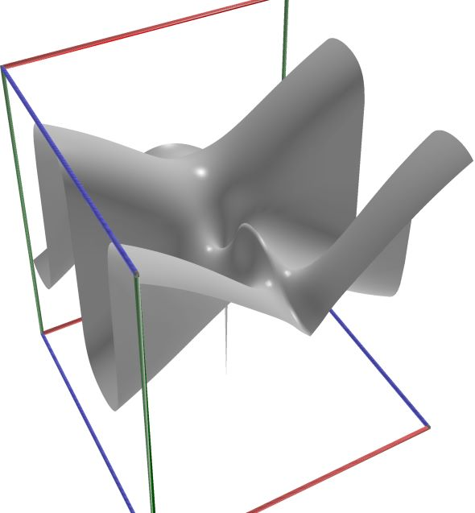

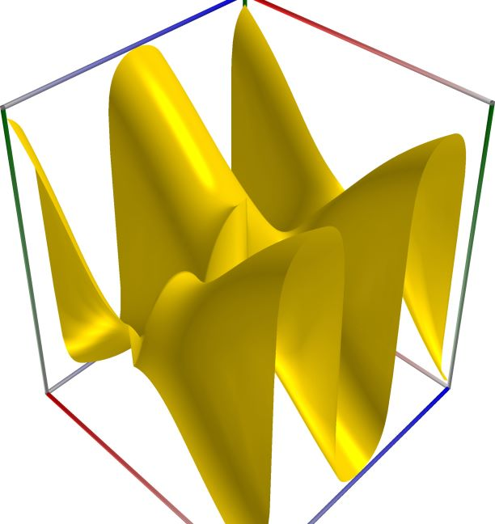

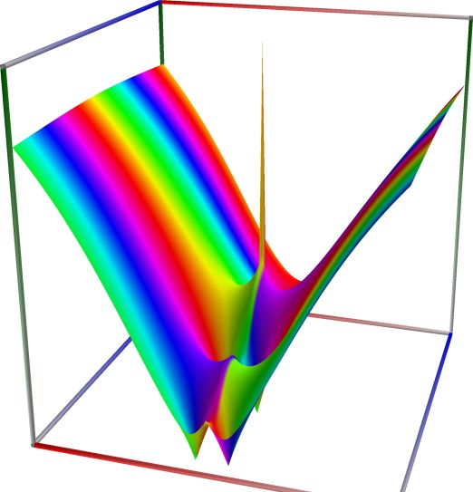

The corresponding scaled function looks like this:

|09a_TestBesselY0e_re| `\quad` |09b_TestBesselY0e_im| `\quad` |09c_TestBesselY0e_abs|

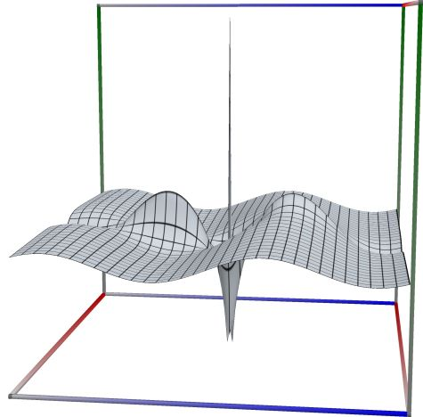

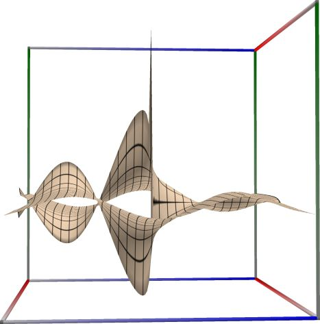

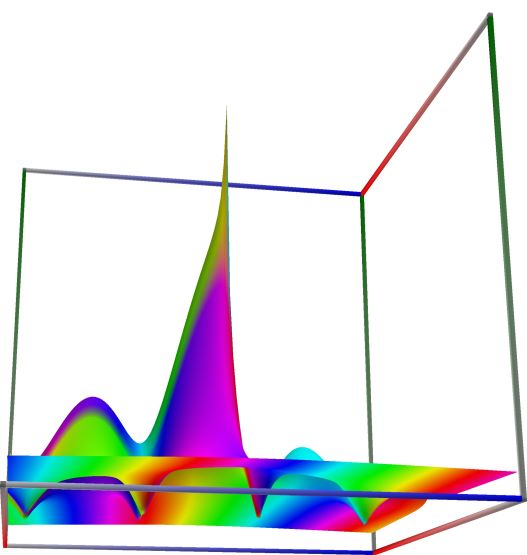

An example with real input:

.. code-block:: pycon

    >>> from xlcalcnet import *
    >>> nu = 5.1; x = 2.7; gui.setdps(90)
    >>> for ctx in gui.ctxlist_noipm_real: print(ctx.fmtname + ': ' + ctx.fmt(ctx.bessel_yv(nu, x, scaled=False)))
        fpm:  -3.13767826537971
        mpm:  -3.13767826537970825707669176672411058089856692306446432254124879743895856786502689900049289
        dpm:  -3.13767826537970825707669176672411058089856692306446432254124879743895856786502689900049289
        gpm:  -3.1376782653797082570766917667241105808985669230644643225412487974389585678650268990004928898
        apm: [-3.137678265379708257076691766724110580898566923064464322541248797438958567865026899000493 +/- 4.00e-88]
     math53:  -3.1376782653797
      sreal:  -3.137678
      dreal:  -3.13767826537971
      ereal:  -3.1376782653797082568
      qreal:  -3.13767826537970825707669176672411
      oreal:  -3.1376782653797082570766917667241105808985669230644643225412487974389585
      mreal:  -3.13767826537970825707669176672411058089856692306446432254124879743895856786502689900049291
     sflint:  -3.137678
     dflint:  -3.13767826537971
     eflint:  -3.1376782653797082566
     qflint:  -3.13767826537970825707669176672411
     oflint:  -3.1376782653797082570766917667241105808985669230644643225412487974389586
     mflint:  -3.13767826537970825707669176672411058089856692306446432254124879743895856786502689900049288
     aflint: [-3.137678265379708257076691766724110580898566923064464322541248797438958567865026899000493 +/- 8.18e-88]

An example with complex input, using C\#-style formatting for complex numbers for the result 

.. code-block:: pycon

    >>> from xlcalcnet import *
    >>> nu = -5.1;  x = 2.7+2j; gui.setdps(40)
    >>> for ctx in [fpm, mpm, cmath53]: print(ctx.fmtname + ': ' + ctx.fmt(ctx.bessel_yv(nu, x, scaled=False)))
        fpm:  (-0.523689380504507, -0.296492970936592)
        mpm:  (-0.5236893805045070818664382470192867591545, -0.2964929709365916643037953528144811375163)
    cmath53:  (-0.523689380504507, -0.296492970936592)

An example with the same complex input as above, showing only the real part of the result:

.. code-block:: pycon

    >>> from xlcalcnet import *
    >>> nu = -5.1;  x = 2.7+2j; gui.setdps(90)
    >>> for ctx in gui.ctxlist_noboost_cplx: 
    ...     print(ctx.fmtname + ': ' +  ctx.realctx.fmt(ctx.real(ctx.bessel_yv(nu, x, scaled=False))))
        fpm:  -0.523689380504507
        mpm:  -0.523689380504507081866438247019286759154537798698775555771206802418380908207367954713829185
        dpm:  -0.523689380504507081866438247019286759154537798698775555771206802418380908207367954713829185
        gpm:  -0.52368938050450708186643824701928675915453779869877555577120680241838090820736795471382918497
        apm: [-0.523689380504507081866438247019286759154537798698775555771206802418380908207367954713829 +/- 2.74e-88]
    cmath53:  -0.523689380504507
    sflintc:  -0.5236893
    dflintc:  -0.523689380504507
    eflintc:  -0.52368938050450708179
    qflintc:  -0.523689380504507081866438247019287
    oflintc:  -0.52368938050450708186643824701928675915453779869877555577120680241838091
    mflintc:  -0.523689380504507081866438247019286759154537798698775555771206802418380908207367954713829184
    aflintc: [-0.523689380504507081866438247019286759154537798698775555771206802418380908207367954713829 +/- 4.20e-88]

An example with the same complex input as above, showing only the imaginary part of the result:

.. code-block:: pycon

    >>> from xlcalcnet import *
    >>> nu = -5.1;  x = 2.7+2j; gui.setdps(90)
    >>> for ctx in gui.ctxlist_noboost_cplx: 
    ...     print(ctx.fmtname + ': ' +  ctx.realctx.fmt(ctx.imag(ctx.bessel_yv(nu, x, scaled=False))))
        fpm:  -0.296492970936592
        mpm:  -0.296492970936591664303795352814481137516255971676956672726544998245130703161352124047598161
        dpm:  -0.296492970936591664303795352814481137516255971676956672726544998245130703161352124047598161
        gpm:  -0.296492970936591664303795352814481137516255971676956672726544998245130703161352124047598161
        apm: [-0.2964929709365916643037953528144811375162559716769566727265449982451307031613521240475982 +/- 8.79e-89]
    cmath53:  -0.296492970936592
    sflintc:  -0.296493
    dflintc:  -0.296492970936592
    eflintc:  -0.29649297093659166433
    qflintc:  -0.296492970936591664303795352814481
    oflintc:  -0.2964929709365916643037953528144811375162559716769566727265449982451307
    mflintc:  -0.296492970936591664303795352814481137516255971676956672726544998245130703161352124047598161
    aflintc: [-0.296492970936591664303795352814481137516255971676956672726544998245130703161352124047598 +/- 2.95e-88]

The above and additional examples can be found online in the ``DataXlCalcNet`` repository or in the corresponding local ``DataXlCalcNet`` folder for `Python (real input) <https://github.com/duhadler/DataXlCalcNet/blob/master/DataXlCalcNet/A01_ExamplesPython/B10_Hypergeometric0F1/C02_BesselGeneral/D02a_BesselYvReal.py>`__, `Python (complex input) <https://github.com/duhadler/DataXlCalcNet/blob/master/DataXlCalcNet/A01_ExamplesPython/B10_Hypergeometric0F1/C02_BesselGeneral/D02b_BesselYvCplx.py>`__, and `C\# (real or complex input) <https://github.com/duhadler/DataXlCalcNet/blob/master/DataXlCalcNet/A02_ExamplesCSharp/B10_Hypergeometric0F1/C02_BesselGeneral/D02_BesselYv.cs>`__. 

|newpage|

First derivative of the Bessel function of the first kind, `J'_{\nu}(x)`
-----------------------------------------------------------------------------------------------

.. method:: ctx.bessel_jv_prime(nu, x, scaled=False)

    Returns `J'_{\nu}(x)`, the first derivative (with respect to `x`) of `J_{\nu}(z)`, the Bessel function of the second kind.

    If *scaled* is *True*, then `J'_{\nu}(x) \cdot \exp(-|\Im(x)|)` is returned, which means that for purely  real `x` just `J'_{\nu}(x)` is returned.  

    See also  Wikipedia :cite:p:`WikipediaFun84`,  MathWorld :cite:p:`WolframFun84`, NIST :cite:p:`DLMFun84`, BoostMath :cite:p:`BoostFun84`, BoostMath :cite:p:`BoostFun145a`.

    If ``ctx`` is ``math53``, ``ctxboost`` or ``ctxflintreal``, then `\nu, x \in \mathbb{R}` is exspected. If ``ctx`` is ``cmath53``, then `\nu \in \mathbb{R}` and `x \in \mathbb{C}` is exspected.  If ``ctx`` is ``ctxflintcplx`` then `\nu, x \in \mathbb{C}` is accepted. 

    The function is calculated as `J'_{\nu}(x) = \tfrac{1}{2} (J_{\nu-1}(x)- J_{\nu+1}(x))`. 

An example with real input:

.. code-block:: pycon

    >>> from xlcalcnet import *
    >>> nu = 5.1; x = 2.7; gui.setdps(90)
    >>> for ctx in gui.ctxlist_noipm_real: print(ctx.fmtname + ': ' + ctx.fmt(ctx.bessel_jv_prime(nu, x, scaled=False)))
        fpm:  0.0396153203893508
        mpm:  0.0396153203893508189334372935612041884282787016218154736368787595657321538962292683509791733
        dpm:  0.0396153203893508189334372935612041884282787016218154736368787595657321538962292683509791733
        gpm:  0.039615320389350818933437293561204188428278701621815473636878759565732153896229268350979173302
        apm: [0.03961532038935081893343729356120418842827870162181547363687875956573215389622926835097917 +/- 5.15e-90]
     math53:  0.0396153203893508
      sreal:  0.03961533
      dreal:  0.0396153203893508
      ereal:  0.039615320389350818983
      qreal:  0.0396153203893508189334372935612042
      oreal:  0.039615320389350818933437293561204188428278701621815473636878759565732167
      mreal:  0.0396153203893508189334372935612041884282787016218154736368787595657321538962292683509791756
     sflint:  0.03961533
     dflint:  0.0396153203893508
     eflint:  0.039615320389350818939
     qflint:  0.0396153203893508189334372935612042
     oflint:  0.039615320389350818933437293561204188428278701621815473636878759565732154
     mflint:  0.0396153203893508189334372935612041884282787016218154736368787595657321538962292683509791734
     aflint: [0.0396153203893508189334372935612041884282787016218154736368787595657321538962292683509792 +/- 3.46e-89]

An example with complex input, using C\#-style formatting for complex numbers for the result 

.. code-block:: pycon

    >>> from xlcalcnet import *
    >>> nu = -5.1;  x = 2.7+2j; gui.setdps(40)
    >>> for ctx in [fpm, mpm, cmath53]: print(ctx.fmtname + ': ' + ctx.fmt(ctx.bessel_jv_prime(nu, x, scaled=False)))
        fpm:  (-0.309016883705514, -0.0169111737702901)
        mpm:  (-0.3090168837055141586025342245377174733157, -0.01691117377029009113544128436904153456987)
    cmath53:  (-0.309016883705513, -0.0169111737702907)

An example with the same complex input as above, showing only the real part of the result:

.. code-block:: pycon

    >>> from xlcalcnet import *
    >>> nu = -5.1;  x = 2.7+2j; gui.setdps(90)
    >>> for ctx in gui.ctxlist_noboost_cplx: 
    ...     print(ctx.fmtname + ': ' +  ctx.realctx.fmt(ctx.real(ctx.bessel_jv_prime(nu, x, scaled=False))))
        fpm:  -0.309016883705514
        mpm:  -0.309016883705514158602534224537717473315738071290333813488761600761794141435208626880980759
        dpm:  -0.309016883705514158602534224537717473315738071290333813488761600761794141435208626880980759
        gpm:  -0.30901688370551415860253422453771747331573807129033381348876160076179414143520862688098075902
        apm: [-0.3090168837055141586025342245377174733157380712903338134887616007617941414352086268809808 +/- 8.28e-89]
    cmath53:  -0.309016883705513
    sflintc:  -0.3090165
    dflintc:  -0.309016883705514
    eflintc:  -0.30901688370551415829
    qflintc:  -0.309016883705514158602534224537716
    oflintc:  -0.30901688370551415860253422453771747331573807129033381348876160076179414
    mflintc:  -0.309016883705514158602534224537717473315738071290333813488761600761794141435208626880980755
    aflintc: [-0.309016883705514158602534224537717473315738071290333813488761600761794141435208626880981 +/- 3.40e-88]

An example with the same complex input as above, showing only the imaginary part of the result:

.. code-block:: pycon

    >>> from xlcalcnet import *
    >>> nu = -5.1;  x = 2.7+2j; gui.setdps(90)
    >>> for ctx in gui.ctxlist_noboost_cplx: 
    ...     print(ctx.fmtname + ': ' +  ctx.realctx.fmt(ctx.imag(ctx.bessel_jv_prime(nu, x, scaled=False))))
        fpm:  -0.0169111737702901
        mpm:  -0.0169111737702900911354412843690415345698388301042216088795665490075425317346474478667111972
        dpm:  -0.0169111737702900911354412843690415345698388301042216088795665490075425317346474478667111972
        gpm:  -0.016911173770290091135441284369041534569838830104221608879566549007542531734647447866711197201
        apm: [-0.0169111737702900911354412843690415345698388301042216088795665490075425317346474478667112 +/- 3.94e-89]
    cmath53:  -0.0169111737702907
    sflintc:  -0.01691135
    dflintc:  -0.0169111737702901
    eflintc:  -0.016911173770290091296
    qflintc:  -0.0169111737702900911354412843690421
    oflintc:  -0.016911173770290091135441284369041534569838830104221608879566549007542532
    mflintc:  -0.016911173770290091135441284369041534569838830104221608879566549007542531734647447866711199
    aflintc: [-0.016911173770290091135441284369041534569838830104221608879566549007542531734647447866711 +/- 2.98e-88]

The above and additional examples can be found online in the ``DataXlCalcNet`` repository or in the corresponding local ``DataXlCalcNet`` folder for `Python (real input) <https://github.com/duhadler/DataXlCalcNet/blob/master/DataXlCalcNet/A01_ExamplesPython/B10_Hypergeometric0F1/C02_BesselGeneral/D03a_BesselJvRealPrime.py>`__, `Python (complex input) <https://github.com/duhadler/DataXlCalcNet/blob/master/DataXlCalcNet/A01_ExamplesPython/B10_Hypergeometric0F1/C02_BesselGeneral/D03b_BesselJvCplxPrime.py>`__, and `C\# (real or complex input) <https://github.com/duhadler/DataXlCalcNet/blob/master/DataXlCalcNet/A02_ExamplesCSharp/B10_Hypergeometric0F1/C02_BesselGeneral/D03_BesselJvPrime.cs>`__. 

|newpage|

First derivative of the Bessel function of the second kind, `Y'_{\nu}(x)`
-----------------------------------------------------------------------------------------------

.. method:: ctx.bessel_yv_prime(nu, x, scaled=False)

    Returns `Y'_{\nu}(x)`, the first derivative (with respect to `x`) of `Y_{\nu}(z)`, the Bessel function of the second kind.

    If *scaled* is *True*, then `Y'_{\nu}(x) \cdot \exp(-|\Im(x)|)` is returned, which means that for purely  real `x` just `Y'_{\nu}(x)` is returned.  

    See also Wikipedia :cite:p:`WikipediaFun85`, MathWorld :cite:p:`WolframFun85`, NIST :cite:p:`DLMFun85`, BoostMath :cite:p:`BoostFun84`, BoostMath :cite:p:`BoostFun145a`.

    If ``ctx`` is ``math53``, ``ctxboost`` or ``ctxflintreal``, then `\nu, x \in \mathbb{R}` is exspected. If ``ctx`` is ``cmath53``, then `\nu \in \mathbb{R}` and `x \in \mathbb{C}` is exspected.  If ``ctx`` is ``ctxflintcplx`` then `\nu, x \in \mathbb{C}` is accepted. 

    The function is calculated as `Y'_{\nu}(x) = \tfrac{1}{2} (Y_{\nu-1}(x)- Y_{\nu+1}(x))`. 

An example with real input:

.. code-block:: pycon

    >>> from xlcalcnet import *
    >>> nu = 5.1; x = 2.7; gui.setdps(90)
    >>> for ctx in gui.ctxlist_noipm_real: print(ctx.fmtname + ': ' + ctx.fmt(ctx.bessel_yv_prime(nu, x, scaled=False)))
        fpm:  4.6645562318231
        mpm:  4.6645562318231032131291215630838281256404812101846847540694728043623556300621306183907958
        dpm:  4.6645562318231032131291215630838281256404812101846847540694728043623556300621306183907958
        gpm:  4.6645562318231032131291215630838281256404812101846847540694728043623556300621306183907957997
        apm: [4.664556231823103213129121563083828125640481210184684754069472804362355630062130618390796 +/- 7.62e-88]
     math53:  4.6645562318231
      sreal:  4.664555
      dreal:  4.6645562318231
      ereal:  4.6645562318231032135
      qreal:  4.66455623182310321312912156308383
      oreal:  4.6645562318231032131291215630838281256404812101846847540694728043623555
      mreal:  4.66455623182310321312912156308382812564048121018468475406947280436235563006213061839079582
     sflint:  4.664555
     dflint:  4.6645562318231
     eflint:  4.6645562318231032122
     qflint:  4.66455623182310321312912156308382
     oflint:  4.6645562318231032131291215630838281256404812101846847540694728043623556
     mflint:  4.66455623182310321312912156308382812564048121018468475406947280436235563006213061839079579
     aflint: [4.66455623182310321312912156308382812564048121018468475406947280436235563006213061839080 +/- 5.55e-87]

An example with complex input, using C\#-style formatting for complex numbers for the result 

.. code-block:: pycon

    >>> from xlcalcnet import *
    >>> nu = -5.1;  x = 2.7+2j; gui.setdps(40)
    >>> for ctx in [fpm, mpm, cmath53]: print(ctx.fmtname + ': ' + ctx.fmt(ctx.bessel_yv_prime(nu, x, scaled=False)))
        fpm:  (1.11751682338529, -0.332993563953313)
        mpm:  (1.117516823385285729694546870897769932556, -0.3329935639533133154191788669089337175851)
    cmath53:  (1.11751682338529, -0.332993563953313)

An example with the same complex input as above, showing only the real part of the result:

.. code-block:: pycon

    >>> from xlcalcnet import *
    >>> nu = -5.1;  x = 2.7+2j; gui.setdps(90)
    >>> for ctx in gui.ctxlist_noboost_cplx: 
    ...     print(ctx.fmtname + ': ' +  ctx.realctx.fmt(ctx.real(ctx.bessel_yv_prime(nu, x, scaled=False))))
        fpm:  1.11751682338529
        mpm:  1.1175168233852857296945468708977699325561660573836657992748513643692850330361769757785503
        dpm:  1.1175168233852857296945468708977699325561660573836657992748513643692850330361769757785503
        gpm:  1.1175168233852857296945468708977699325561660573836657992748513643692850330361769757785503
        apm: [1.117516823385285729694546870897769932556166057383665799274851364369285033036176975778550 +/- 4.48e-88]
    cmath53:  1.11751682338529
    sflintc:  1.117517
    dflintc:  1.11751682338529
    eflintc:  1.1175168233852857297
    qflintc:  1.11751682338528572969454687089777
    oflintc:  1.117516823385285729694546870897769932556166057383665799274851364369285
    mflintc:  1.1175168233852857296945468708977699325561660573836657992748513643692850330361769757785503
    aflintc: [1.117516823385285729694546870897769932556166057383665799274851364369285033036176975778550 +/- 6.86e-88]

An example with the same complex input as above, showing only the imaginary part of the result:

.. code-block:: pycon

    >>> from xlcalcnet import *
    >>> nu = -5.1;  x = 2.7+2j; gui.setdps(90)
    >>> for ctx in gui.ctxlist_noboost_cplx: 
    ...     print(ctx.fmtname + ': ' +  ctx.realctx.fmt(ctx.imag(ctx.bessel_yv_prime(nu, x, scaled=False))))
        fpm:  -0.332993563953313
        mpm:  -0.332993563953313315419178866908933717585170038242344594733356982786113649736801021220545373
        dpm:  -0.332993563953313315419178866908933717585170038242344594733356982786113649736801021220545373
        gpm:  -0.33299356395331331541917886690893371758517003824234459473335698278611364973680102122054537298
        apm: [-0.332993563953313315419178866908933717585170038242344594733356982786113649736801021220545 +/- 5.12e-88]
    cmath53:  -0.332993563953313
    sflintc:  -0.3329934
    dflintc:  -0.332993563953313
    eflintc:  -0.33299356395331331527
    qflintc:  -0.332993563953313315419178866908933
    oflintc:  -0.33299356395331331541917886690893371758517003824234459473335698278611365
    mflintc:  -0.332993563953313315419178866908933717585170038242344594733356982786113649736801021220545371
    aflintc: [-0.332993563953313315419178866908933717585170038242344594733356982786113649736801021220545 +/- 7.45e-88]

The above and additional examples can be found online in the ``DataXlCalcNet`` repository or in the corresponding local ``DataXlCalcNet`` folder for `Python (real input) <https://github.com/duhadler/DataXlCalcNet/blob/master/DataXlCalcNet/A01_ExamplesPython/B10_Hypergeometric0F1/C02_BesselGeneral/D04a_BesselYvRealPrime.py>`__, `Python (complex input) <https://github.com/duhadler/DataXlCalcNet/blob/master/DataXlCalcNet/A01_ExamplesPython/B10_Hypergeometric0F1/C02_BesselGeneral/D04b_BesselYvCplxPrime.py>`__, and `C\# (real or complex input) <https://github.com/duhadler/DataXlCalcNet/blob/master/DataXlCalcNet/A02_ExamplesCSharp/B10_Hypergeometric0F1/C02_BesselGeneral/D04_BesselYvPrime.cs>`__. 

|newpage|

Boost: Zeros `j_{\nu, m}` of the Bessel function of the first kind: `J_{\nu}(j_{\nu, m})=0`
-----------------------------------------------------------------------------------------------

.. method:: ctx.bessel_jv_zero(nu, m)

    where ``ctx`` is ``math53`` or ``ctxboost``.

    For a real order `\nu \ge 0` and a positive integer `m`, returns  `j_{\nu, m}`, the `m`-th positive zero of the Bessel function of the first kind `J_{\nu}(x)`.  

    See also  Wikipedia :cite:p:`WikipediaFun84`,  MathWorld :cite:p:`WolframFun141a`, NIST :cite:p:`DLMFun141`, BoostMath :cite:p:`BoostFun141`, Mpmath :cite:p:`MpmathFun141`.

An example:

.. code-block:: pycon

    >>> from xlcalcnet import *
    >>> nu = 5.1; m = 2; gui.setdps(90)
    >>> for ctx in gui.ctxlist_boost_real: print(ctx.fmtname + ': ' + ctx.fmt(ctx.bessel_jv_zero(nu, m)))
        fpm:  12.4646301244606
        mpm:  12.4646301244605866142629419125009075206807471860210514223772120418977903945771103587089731
        dpm:  12.4646301244605866142629419125009075206807471860210514223772120418977903945771103587089731
        gpm:  12.4646301244605866142629419125009075206807471860210514223772120418977903945771103587089731
        apm: [12.4646301244605866142629419125009075206807471860210514223772120418977903945771103587089731 +/- 3.60e-90]
     math53:  12.4646301244606
      sreal:  12.46463
      dreal:  12.4646301244606
      ereal:  12.464630124460586615
      qreal:  12.4646301244605866142629419125009
      oreal:  12.46463012446058661426294191250090752068074718602105142237721204189779
      mreal:  12.4646301244605866142629419125009075206807471860210514223772120418977903945771103587089731

The above and additional examples can be found online in the ``DataXlCalcNet`` repository or in the corresponding local ``DataXlCalcNet`` folder for `Python (real input) <https://github.com/duhadler/DataXlCalcNet/blob/master/DataXlCalcNet/A01_ExamplesPython/B10_Hypergeometric0F1/C02_BesselGeneral/D05a_BesselJvZero.py>`__  and `C\# (real input) <https://github.com/duhadler/DataXlCalcNet/blob/master/DataXlCalcNet/A02_ExamplesCSharp/B10_Hypergeometric0F1/C02_BesselGeneral/D05_BesselJvZero.cs>`__. 

|newpage|

Boost: Zeros `y_{\nu, m}` of the Bessel function of the first kind: `Y_{\nu}(y_{\nu, m})=0`
-----------------------------------------------------------------------------------------------

.. method:: ctx.bessel_yv_zero(nu, m)

    where ``ctx`` is ``math53`` or ``ctxboost``.

    For a real order `\nu \ge 0` and a positive integer `m`, returns  `y_{\nu, m}`, the `m`-th positive zero of the Bessel function of the second kind `Y_{\nu}(x)`. 

    See also  Wikipedia :cite:p:`WikipediaFun85`,  MathWorld :cite:p:`WolframFun141b`, NIST :cite:p:`DLMFun141`, BoostMath :cite:p:`BoostFun141`, Mpmath :cite:p:`MpmathFun141a`.

An example:

.. code-block:: pycon

    >>> from xlcalcnet import *
    >>> nu = 5.1; m = 2; gui.setdps(90)
    >>> for ctx in gui.ctxlist_boost_real: print(ctx.fmtname + ': ' + ctx.fmt(ctx.bessel_yv_zero(nu, m)))
        fpm:  10.7194508132507
        mpm:  10.7194508132507186738370556044871147406004432940132831264452725266682131766802395992966258
        dpm:  10.7194508132507186738370556044871147406004432940132831264452725266682131766802395992966258
        gpm:  10.7194508132507186738370556044871147406004432940132831264452725266682131766802395992966258
        apm: [10.7194508132507186738370556044871147406004432940132831264452725266682131766802395992966258 +/- 3.48e-90]
     math53:  10.7194508132507
      sreal:  10.71945
      dreal:  10.7194508132507
      ereal:  10.719450813250718675
      qreal:  10.7194508132507186738370556044871
      oreal:  10.719450813250718673837055604487114740600443294013283126445272526668213
      mreal:  10.7194508132507186738370556044871147406004432940132831264452725266682131766802395992966258

The above and additional examples can be found online in the ``DataXlCalcNet`` repository or in the corresponding local ``DataXlCalcNet`` folder for `Python (real input) <https://github.com/duhadler/DataXlCalcNet/blob/master/DataXlCalcNet/A01_ExamplesPython/B10_Hypergeometric0F1/C02_BesselGeneral/D06a_BesselYvZero.py>`__  and `C\# (real input) <https://github.com/duhadler/DataXlCalcNet/blob/master/DataXlCalcNet/A02_ExamplesCSharp/B10_Hypergeometric0F1/C02_BesselGeneral/D06_BesselYvZero.cs>`__. 

