

.. |newpage| raw:: latex

   \newpage

.. |br| raw:: html

    

|newpage|

Modified Bessel functions
===============================================================================

Modified Bessel function of the 1st kind, `I_{\nu}(x)`
-----------------------------------------------------------------------------------------

.. method:: ctx.bessel_iv(x, nu, scaled=False)

    Returns `I_{\nu}(x)`, the modified Bessel function of the first kind.

    If *scaled* is *True*, then `I_{\nu}(x) \cdot \exp(-|\Re(x)|)` is returned.

    See also  Wikipedia :cite:p:`WikipediaFun86`,  MathWorld :cite:p:`WolframFun86`, NIST :cite:p:`DLMFun86`, BoostMath :cite:p:`BoostFun86`, :cite:t:`Ehrhardt2018` (3.1.4.1), Flint :cite:p:`FlintFun84`, Flint :cite:p:`FlintFun86`, Mpmath :cite:p:`MpmathFun86`.

    If ``ctx`` is ``math53``, ``ctxboost`` or ``ctxflintreal``, then `\nu, x \in \mathbb{R}` is exspected. If ``ctx`` is ``cmath53``, then `\nu \in \mathbb{R}` and `x \in \mathbb{C}` is exspected.  If ``ctx`` is ``ctxflintcplx`` then `\nu, x \in \mathbb{C}` is accepted. 

    The function is defined as

    .. math:: I_{\nu}\left(z\right) = z^{\nu} (iz)^{-\nu} J_{\nu}(iz) = \frac{1}{\Gamma(\nu+1)} \left(\frac{z}{2}\right)^{\nu} {}_0F_1\left(\nu+1, \frac{z^2}{4}\right).

    The :ref:`wpf figures <rst_wpf_complex_function>` below are showing the real part (left figure), imaginary part (middle figure) and absolute value with color-coded phase (right figure) of the complex function `z = I_{\nu}(x + iy)` with `\nu=0` and  `-6 \le x \le 6` (blue axis), `-6 \le y \le 6` (red axis), `-10 \le z \le 10` (green axis). Function values are :ref:`loglog-transformed <rst_mpm_loglog_transformation>`.

|10a_TestBesselI0_re| `\quad` |10b_TestBesselI0_im| `\quad` |10c_TestBesselI0_abs|

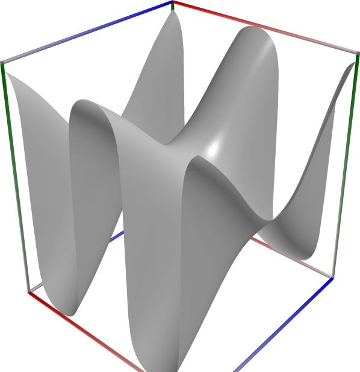

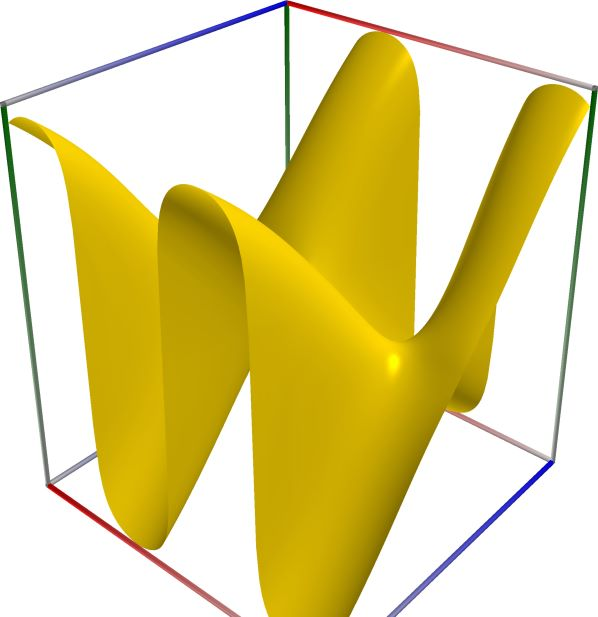

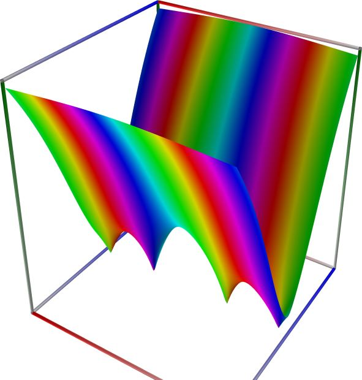

The corresponding scaled function looks like this:

|11a_TestBesselI0e_re| `\quad` |11b_TestBesselI0e_im| `\quad` |11c_TestBesselI0e_abs|

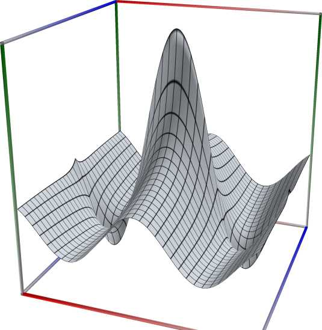

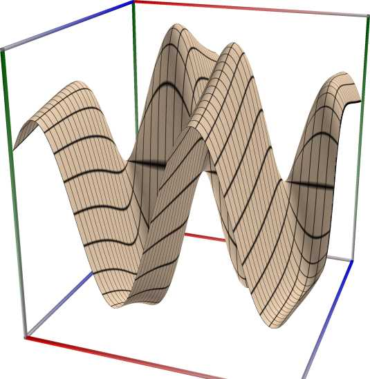

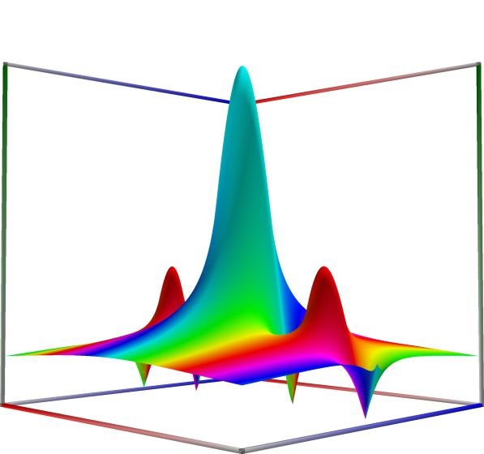

An example with real input:

.. code-block:: pycon

    >>> from xlcalcnet import *
    >>> nu = 5.1; x = 2.7; gui.setdps(90)
    >>> for ctx in gui.ctxlist_noipm_real: print(ctx.fmtname + ': ' + ctx.fmt(ctx.bessel_iv(nu, x, scaled=False)))
        fpm:  0.0434694842377312
        mpm:  0.0434694842377312073534103918235828356904494954117926910342894148302065668060004525484813936
        dpm:  0.0434694842377312073534103918235828356904494954117926910342894148302065668060004525484813936
        gpm:  0.043469484237731207353410391823582835690449495411792691034289414830206566806000452548481393598
        apm: [0.04346948423773120735341039182358283569044949541179269103428941483020656680600045254848139 +/- 5.38e-90]
     math53:  0.0434694842377312
      sreal:  0.0434695
      dreal:  0.0434694842377312
      ereal:  0.043469484237731207353
      qreal:  0.0434694842377312073534103918235828
      oreal:  0.043469484237731207353410391823582835690449495411792691034289414830206561
      mreal:  0.0434694842377312073534103918235828356904494954117926910342894148302065668060004525484813932
     sflint:  0.0434695
     dflint:  0.0434694842377312
     eflint:  0.043469484237731207364
     qflint:  0.0434694842377312073534103918235829
     oflint:  0.043469484237731207353410391823582835690449495411792691034289414830206567
     mflint:  0.0434694842377312073534103918235828356904494954117926910342894148302065668060004525484813937
     aflint: [0.0434694842377312073534103918235828356904494954117926910342894148302065668060004525484814 +/- 1.39e-89]

An example with complex input, using C\#-style formatting for complex numbers for the result 

.. code-block:: pycon

    >>> from xlcalcnet import *
    >>> nu = -5.1;  x = 2.7+2j; gui.setdps(40)
    >>> for ctx in [fpm, mpm, cmath53]: print(ctx.fmtname + ': ' + ctx.fmt(ctx.bessel_iv(nu, x, scaled=False)))
        fpm:  (0.016900173220067, -0.160170196849101)
        mpm:  (0.01690017322006700345883672989570509799631, -0.160170196849101174173806056456738757786)
    cmath53:  (0.016900173220066, -0.1601701968491)

An example with the same complex input as above, showing only the real part of the result:

.. code-block:: pycon

    >>> from xlcalcnet import *
    >>> nu = -5.1;  x = 2.7+2j; gui.setdps(90)
    >>> for ctx in gui.ctxlist_noboost_cplx: 
    ...     print(ctx.fmtname + ': ' +  ctx.realctx.fmt(ctx.real(ctx.bessel_iv(nu, x, scaled=False))))
        fpm:  0.016900173220067
        mpm:  0.0169001732200670034588367298957050979963422355156025534964552219856080058879971268316243824
        dpm:  0.0169001732200670034588367298957050979963422355156025534964552219856080058879971268316243824
        gpm:  0.016900173220067003458836729895705097996342235515602553496455221985608005887997126831624382401
        apm: [0.0169001732200670034588367298957050979963422355156025534964552219856080058879971268316244 +/- 2.75e-89]
    cmath53:  0.016900173220066
    sflintc:  0.01690003
    dflintc:  0.016900173220067
    eflintc:  0.01690017322006700333
    qflintc:  0.0169001732200670034588367298957046
    oflintc:  0.016900173220067003458836729895705097996342235515602553496455221985608006
    mflintc:  0.016900173220067003458836729895705097996342235515602553496455221985608005887997126831624381
    aflintc: [0.0169001732200670034588367298957050979963422355156025534964552219856080058879971268316244 +/- 3.60e-89]

An example with the same complex input as above, showing only the imaginary part of the result:

.. code-block:: pycon

    >>> from xlcalcnet import *
    >>> nu = -5.1;  x = 2.7+2j; gui.setdps(90)
    >>> for ctx in gui.ctxlist_noboost_cplx: 
    ...     print(ctx.fmtname + ': ' +  ctx.realctx.fmt(ctx.imag(ctx.bessel_iv(nu, x, scaled=False))))
        fpm:  -0.160170196849101
        mpm:  -0.160170196849101174173806056456738757786005471343219670363649787195370844923864595585549048
        dpm:  -0.160170196849101174173806056456738757786005471343219670363649787195370844923864595585549048
        gpm:  -0.16017019684910117417380605645673875778600547134321967036364978719537084492386459558554904799
        apm: [-0.1601701968491011741738060564567387577860054713432196703636497871953708449238645955855490 +/- 6.17e-89]
    cmath53:  -0.1601701968491
    sflintc:  -0.1601701
    dflintc:  -0.160170196849101
    eflintc:  -0.16017019684910117406
    qflintc:  -0.160170196849101174173806056456738
    oflintc:  -0.16017019684910117417380605645673875778600547134321967036364978719537085
    mflintc:  -0.160170196849101174173806056456738757786005471343219670363649787195370844923864595585549047
    aflintc: [-0.1601701968491011741738060564567387577860054713432196703636497871953708449238645955855490 +/- 8.34e-89]

The above and additional examples can be found online in the ``DataXlCalcNet`` repository or in the corresponding local ``DataXlCalcNet`` folder for `Python (real input) <https://github.com/duhadler/DataXlCalcNet/blob/master/DataXlCalcNet/A01_ExamplesPython/B10_Hypergeometric0F1/C03_ModifiedBessel/D01a_BesselIvReal.py>`__, `Python (complex input) <https://github.com/duhadler/DataXlCalcNet/blob/master/DataXlCalcNet/A01_ExamplesPython/B10_Hypergeometric0F1/C03_ModifiedBessel/D01b_BesselIvCplx.py>`__, and `C\# (real or complex input) <https://github.com/duhadler/DataXlCalcNet/blob/master/DataXlCalcNet/A02_ExamplesCSharp/B10_Hypergeometric0F1/C03_ModifiedBessel/D01_BesselIv.cs>`__. 

|newpage|

Modified Bessel function of the 2nd kind, `K_{\nu}(x)`
-----------------------------------------------------------------------------------------

.. method:: ctx.bessel_kv(x, nu, scaled=False)

    Returns `K_{\nu}(x)`, the modified Bessel function of the second kind.

    If *scaled* is *True*, then `K_{\nu}(x) \cdot \exp(x)` is returned.

    See also  Wikipedia :cite:p:`WikipediaFun86`,  MathWorld :cite:p:`WolframFun87`, NIST :cite:p:`DLMFun87`, BoostMath :cite:p:`BoostFun86`, :cite:t:`Ehrhardt2018` (3.1.4.3), Flint :cite:p:`FlintFun84`, Flint :cite:p:`FlintFun86`, Mpmath :cite:p:`MpmathFun87`.

    If ``ctx`` is ``math53``, ``ctxboost`` or ``ctxflintreal``, then `\nu, x \in \mathbb{R}` is exspected. If ``ctx`` is ``cmath53``, then `\nu \in \mathbb{R}` and `x \in \mathbb{C}` is exspected.  If ``ctx`` is ``ctxflintcplx`` then `\nu, x \in \mathbb{C}` is accepted. 

    The function is defined as

    .. math:: K_{\nu}\left(z\right)=\tfrac{1}{2}\pi\frac{I_{-\nu}\left(z\right)-I_{\nu}\left(z\right)}{\sin\left(\nu\pi\right)}.

    if `\nu \notin \mathbb{Z}`. If `\nu \in \mathbb{Z}`, it computes the limit value.

    The :ref:`wpf figures <rst_wpf_complex_function>` below are showing the real part (left figure), imaginary part (middle figure) and absolute value with color-coded phase (right figure) of the complex function `z = K_{\nu}(x + iy)` with `\nu=0` and  `-6 \le x \le 6` (blue axis), `-6 \le y \le 6` (red axis), `-10 \le z \le 10` (green axis). Function values are :ref:`loglog-transformed <rst_mpm_loglog_transformation>`.

|12a_TestBesselK0_re| `\quad` |12b_TestBesselK0_im| `\quad` |12c_TestBesselK0_abs|

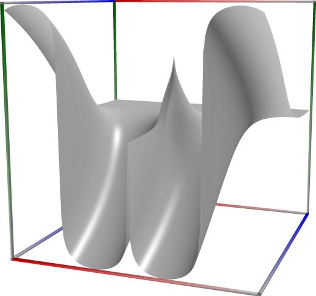

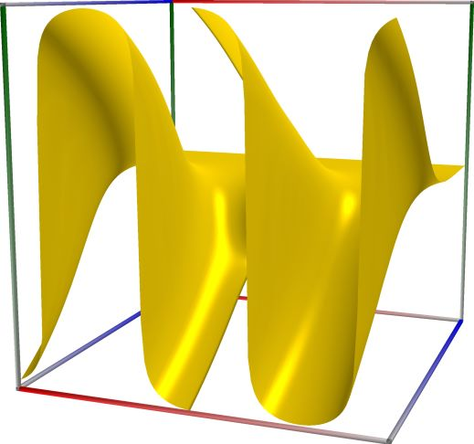

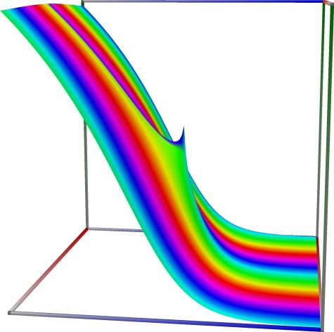

The corresponding scaled function looks like this:

|13a_TestBesselK0e_re| `\quad` |13b_TestBesselK0e_im| `\quad` |13c_TestBesselK0e_abs|

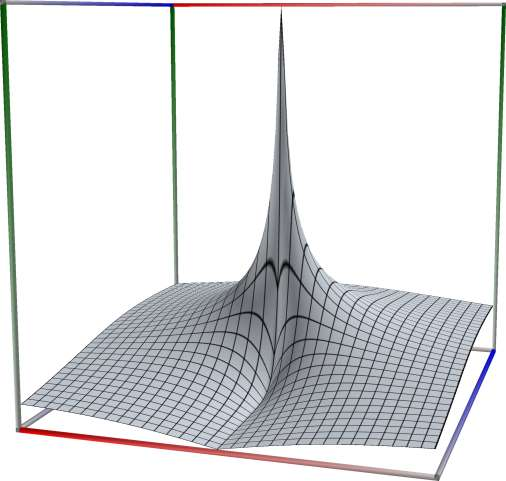

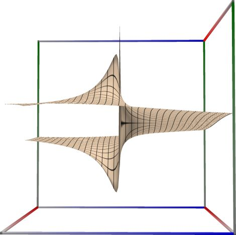

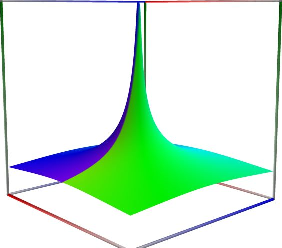

An example with real input:

.. code-block:: pycon

    >>> from xlcalcnet import *
    >>> nu = 5.1; x = 2.7; gui.setdps(90)
    >>> for ctx in gui.ctxlist_noipm_real: print(ctx.fmtname + ': ' + ctx.fmt(ctx.bessel_kv(nu, x, scaled=False)))
        fpm:  1.98858962407752
        mpm:  1.98858962407751854880797961385042513868175087335792910381894335630323508957065913447413126
        dpm:  1.98858962407751854880797961385042513868175087335792910381894335630323508957065913447413126
        gpm:  1.98858962407751854880797961385042513868175087335792910381894335630323508957065913447413126
        apm: [1.988589624077518548807979613850425138681750873357929103818943356303235089570659134474131 +/- 3.97e-88]
     math53:  1.98858962407752
      sreal:  1.988589
      dreal:  1.98858962407752
      ereal:  1.9885896240775185487
      qreal:  1.98858962407751854880797961385043
      oreal:  1.9885896240775185488079796138504251386817508733579291038189433563032354
      mreal:  1.98858962407751854880797961385042513868175087335792910381894335630323508957065913447413128
     sflint:  1.988589
     dflint:  1.98858962407752
     eflint:  1.9885896240775185484
     qflint:  1.98858962407751854880797961385042
     oflint:  1.9885896240775185488079796138504251386817508733579291038189433563032351
     mflint:  1.98858962407751854880797961385042513868175087335792910381894335630323508957065913447413126
     aflint: [1.988589624077518548807979613850425138681750873357929103818943356303235089570659134474131 +/- 6.45e-88]

An example with complex input, using C\#-style formatting for complex numbers for the result 

.. code-block:: pycon

    >>> from xlcalcnet import *
    >>> nu = -5.1;  x = 2.7+2j; gui.setdps(40)
    >>> for ctx in [fpm, mpm, cmath53]: print(ctx.fmtname + ': ' + ctx.fmt(ctx.bessel_kv(nu, x, scaled=False)))
        fpm:  (-0.584337586266497, 0.513026027889269)
        mpm:  (-0.58433758626649685448039516555907823033, 0.5130260278892691179956516897260840995879)
    cmath53:  (-0.584337586266497, 0.513026027889268)

An example with the same complex input as above, showing only the real part of the result:

.. code-block:: pycon

    >>> from xlcalcnet import *
    >>> nu = -5.1;  x = 2.7+2j; gui.setdps(90)
    >>> for ctx in gui.ctxlist_noboost_cplx: 
    ...     print(ctx.fmtname + ': ' +  ctx.realctx.fmt(ctx.real(ctx.bessel_kv(nu, x, scaled=False))))
        fpm:  -0.584337586266497
        mpm:  -0.58433758626649685448039516555907823033005644315177073918163082214331697228472077858545503
        dpm:  -0.58433758626649685448039516555907823033005644315177073918163082214331697228472077858545503
        gpm:  -0.58433758626649685448039516555907823033005644315177073918163082214331697228472077858545503005
        apm: [-0.584337586266496854480395165559078230330056443151770739181630822143316972284720778585455 +/- 1.05e-88]
    cmath53:  -0.584337586266497
    sflintc:  -0.5843375
    dflintc:  -0.584337586266497
    eflintc:  -0.5843375862664968544
    qflintc:  -0.584337586266496854480395165559078
    oflintc:  -0.58433758626649685448039516555907823033005644315177073918163082214331697
    mflintc:  -0.58433758626649685448039516555907823033005644315177073918163082214331697228472077858545503
    aflintc: [-0.584337586266496854480395165559078230330056443151770739181630822143316972284720778585455 +/- 2.35e-88]

An example with the same complex input as above, showing only the imaginary part of the result:

.. code-block:: pycon

    >>> from xlcalcnet import *
    >>> nu = -5.1;  x = 2.7+2j; gui.setdps(90)
    >>> for ctx in gui.ctxlist_noboost_cplx: 
    ...     print(ctx.fmtname + ': ' +  ctx.realctx.fmt(ctx.imag(ctx.bessel_kv(nu, x, scaled=False))))
        fpm:  0.513026027889269
        mpm:  0.513026027889269117995651689726084099587946795864575982326898705437040313702817305657770566
        dpm:  0.513026027889269117995651689726084099587946795864575982326898705437040313702817305657770566
        gpm:  0.51302602788926911799565168972608409958794679586457598232689870543704031370281730565777056602
        apm: [0.513026027889269117995651689726084099587946795864575982326898705437040313702817305657771 +/- 5.35e-88]
    cmath53:  0.513026027889268
    sflintc:  0.5130259
    dflintc:  0.513026027889269
    eflintc:  0.51302602788926911784
    qflintc:  0.513026027889269117995651689726084
    oflintc:  0.51302602788926911799565168972608409958794679586457598232689870543704031
    mflintc:  0.513026027889269117995651689726084099587946795864575982326898705437040313702817305657770565
    aflintc: [0.513026027889269117995651689726084099587946795864575982326898705437040313702817305657771 +/- 6.89e-88]

The above and additional examples can be found online in the ``DataXlCalcNet`` repository or in the corresponding local ``DataXlCalcNet`` folder for `Python (real input) <https://github.com/duhadler/DataXlCalcNet/blob/master/DataXlCalcNet/A01_ExamplesPython/B10_Hypergeometric0F1/C03_ModifiedBessel/D02a_BesselKvReal.py>`__, `Python (complex input) <https://github.com/duhadler/DataXlCalcNet/blob/master/DataXlCalcNet/A01_ExamplesPython/B10_Hypergeometric0F1/C03_ModifiedBessel/D02b_BesselKvCplx.py>`__, and `C\# (real or complex input) <https://github.com/duhadler/DataXlCalcNet/blob/master/DataXlCalcNet/A02_ExamplesCSharp/B10_Hypergeometric0F1/C03_ModifiedBessel/D02_BesselKv.cs>`__. 

|newpage|

First derivative of the modified Bessel function of the first kind `I'_{\nu}(x)`
--------------------------------------------------------------------------------------------

.. method:: ctx.bessel_iv_prime(x, nu, scaled=False)

    Returns `I'_{\nu}(x)`, the first derivative (with respect to `x`) of `I_{\nu}(z)`, the modified Bessel function of the first kind

    If *scaled* is *True*, then `I'_{\nu}(x) \cdot \exp(-|\Re(x)|)` is returned.

    See also  Wikipedia :cite:p:`WikipediaFun86`,  MathWorld :cite:p:`WolframFun86`, NIST :cite:p:`DLMFun86`, BoostMath :cite:p:`BoostFun86`, BoostMath :cite:p:`BoostFun145a`.

    If ``ctx`` is ``math53``, ``ctxboost`` or ``ctxflintreal``, then `\nu, x \in \mathbb{R}` is exspected. If ``ctx`` is ``cmath53``, then `\nu \in \mathbb{R}` and `x \in \mathbb{C}` is exspected.  If ``ctx`` is ``ctxflintcplx`` then `\nu, x \in \mathbb{C}` is accepted. 

    The function is calculated as  `I'_{\nu}(x) = \tfrac{1}{2} (I_{\nu-1}(x) + I_{\nu+1}(x))`. 

An example with real input:

.. code-block:: pycon

    >>> from xlcalcnet import *
    >>> nu = 5.1; x = 2.7; gui.setdps(90)
    >>> for ctx in gui.ctxlist_noipm_real: print(ctx.fmtname + ': ' + ctx.fmt(ctx.bessel_iv_prime(nu, x, scaled=False)))
        fpm:  0.0913520448477437
        mpm:  0.0913520448477437243746041899878402209545699777192941010173134128156743435844400871825998583
        dpm:  0.0913520448477437243746041899878402209545699777192941010173134128156743435844400871825998583
        gpm:  0.091352044847743724374604189987840220954569977719294101017313412815674343584440087182599858304
        apm: [0.09135204484774372437460418998784022095456997771929410101731341281567434358444008718259986 +/- 5.46e-90]
     math53:  0.0913520448477438
      sreal:  0.09135206
      dreal:  0.0913520448477438
      ereal:  0.091352044847743724384
      qreal:  0.0913520448477437243746041899878401
      oreal:  0.091352044847743724374604189987840220954569977719294101017313412815674331
      mreal:  0.0913520448477437243746041899878402209545699777192941010173134128156743435844400871825998576
     sflint:  0.09135206
     dflint:  0.0913520448477437
     eflint:  0.091352044847743724391
     qflint:  0.0913520448477437243746041899878403
     oflint:  0.091352044847743724374604189987840220954569977719294101017313412815674343
     mflint:  0.0913520448477437243746041899878402209545699777192941010173134128156743435844400871825998585
     aflint: [0.0913520448477437243746041899878402209545699777192941010173134128156743435844400871825999 +/- 5.77e-89]

An example with complex input, using C\#-style formatting for complex numbers for the result 

.. code-block:: pycon

    >>> from xlcalcnet import *
    >>> nu = -5.1;  x = 2.7+2j; gui.setdps(40)
    >>> for ctx in [fpm, mpm, cmath53]: print(ctx.fmtname + ': ' + ctx.fmt(ctx.bessel_iv_prime(nu, x, scaled=False)))
        fpm:  (-0.290892499433961, 0.228501281902868)
        mpm:  (-0.2908924994339605087319696863791633161403, 0.2285012819028680066552123576914964313566)
    cmath53:  (-0.29089249943396, 0.228501281902866)

An example with the same complex input as above, showing only the real part of the result:

.. code-block:: pycon

    >>> from xlcalcnet import *
    >>> nu = -5.1;  x = 2.7+2j; gui.setdps(90)
    >>> for ctx in gui.ctxlist_noboost_cplx: 
    ...     print(ctx.fmtname + ': ' +  ctx.realctx.fmt(ctx.real(ctx.bessel_iv_prime(nu, x, scaled=False))))
        fpm:  -0.290892499433961
        mpm:  -0.290892499433960508731969686379163316140320774280772886206116572882977565571284427834820434
        dpm:  -0.290892499433960508731969686379163316140320774280772886206116572882977565571284427834820434
        gpm:  -0.290892499433960508731969686379163316140320774280772886206116572882977565571284427834820434
        apm: [-0.2908924994339605087319696863791633161403207742807728862061165728829775655712844278348204 +/- 7.06e-89]
    cmath53:  -0.29089249943396
    sflintc:  -0.2908925
    dflintc:  -0.290892499433961
    eflintc:  -0.29089249943396050868
    qflintc:  -0.290892499433960508731969686379163
    oflintc:  -0.29089249943396050873196968637916331614032077428077288620611657288297756
    mflintc:  -0.290892499433960508731969686379163316140320774280772886206116572882977565571284427834820433
    aflintc: [-0.290892499433960508731969686379163316140320774280772886206116572882977565571284427834820 +/- 5.33e-88]

An example with the same complex input as above, showing only the imaginary part of the result:

.. code-block:: pycon

    >>> from xlcalcnet import *
    >>> nu = -5.1;  x = 2.7+2j; gui.setdps(90)
    >>> for ctx in gui.ctxlist_noboost_cplx: 
    ...     print(ctx.fmtname + ': ' +  ctx.realctx.fmt(ctx.imag(ctx.bessel_iv_prime(nu, x, scaled=False))))
        fpm:  0.228501281902868
        mpm:  0.228501281902868006655212357691496431356683575146681423442682662536937297205523747778624651
        dpm:  0.228501281902868006655212357691496431356683575146681423442682662536937297205523747778624651
        gpm:  0.228501281902868006655212357691496431356683575146681423442682662536937297205523747778624651
        apm: [0.2285012819028680066552123576914964313566835751466814234426826625369372972055237477786246 +/- 8.35e-89]
    cmath53:  0.228501281902866
    sflintc:  0.228501
    dflintc:  0.228501281902868
    eflintc:  0.22850128190286800641
    qflintc:  0.228501281902868006655212357691496
    oflintc:  0.2285012819028680066552123576914964313566835751466814234426826625369373
    mflintc:  0.228501281902868006655212357691496431356683575146681423442682662536937297205523747778624648
    aflintc: [0.228501281902868006655212357691496431356683575146681423442682662536937297205523747778625 +/- 4.47e-88]

The above and additional examples can be found online in the ``DataXlCalcNet`` repository or in the corresponding local ``DataXlCalcNet`` folder for `Python (real input) <https://github.com/duhadler/DataXlCalcNet/blob/master/DataXlCalcNet/A01_ExamplesPython/B10_Hypergeometric0F1/C03_ModifiedBessel/D03a_BesselIvRealPrime.py>`__, `Python (complex input) <https://github.com/duhadler/DataXlCalcNet/blob/master/DataXlCalcNet/A01_ExamplesPython/B10_Hypergeometric0F1/C03_ModifiedBessel/D03b_BesselIvCplxPrime.py>`__, and `C\# (real or complex input) <https://github.com/duhadler/DataXlCalcNet/blob/master/DataXlCalcNet/A02_ExamplesCSharp/B10_Hypergeometric0F1/C03_ModifiedBessel/D03_BesselIvPrime.cs>`__. 

|newpage|

First derivative of the modified Bessel function of the second kind `K'_{\nu}(x)`
--------------------------------------------------------------------------------------------

.. method:: ctx.bessel_kv_prime(x, nu, scaled=False)

    Returns `K'_{\nu}(x)`, the first derivative (with respect to `x`) of `K_{\nu}(x)`, the modified Bessel function of the second kind.

    If *scaled* is *True*, then `K'_{\nu}(x) \cdot \exp(x)` is returned.

    See also  Wikipedia :cite:p:`WikipediaFun84`, MathWorld :cite:p:`WolframFun84`, NIST :cite:p:`DLMFun84`, BoostMath :cite:p:`BoostFun84`, BoostMath :cite:p:`BoostFun145a`.

    If ``ctx`` is ``math53``, ``ctxboost`` or ``ctxflintreal``, then `\nu, x \in \mathbb{R}` is exspected. If ``ctx`` is ``cmath53``, then `\nu \in \mathbb{R}` and `x \in \mathbb{C}` is exspected.  If ``ctx`` is ``ctxflintcplx`` then `\nu, x \in \mathbb{C}` is accepted. 

    The function is calculated as `K'_{\nu}(x) = -\tfrac{1}{2} (K_{\nu-1}(x) + K_{\nu+1}(x))`.

An example with real input:

.. code-block:: pycon

    >>> from xlcalcnet import *
    >>> nu = 5.1; x = 2.7; gui.setdps(90)
    >>> for ctx in gui.ctxlist_noipm_real: print(ctx.fmtname + ': ' + ctx.fmt(ctx.bessel_kv_prime(nu, x, scaled=False)))
        fpm:  -4.34117508309623
        mpm:  -4.34117508309623064501224420014982028888022099335052959538761810805925027920544206832712634
        dpm:  -4.34117508309623064501224420014982028888022099335052959538761810805925027920544206832712634
        gpm:  -4.3411750830962306450122442001498202888802209933505295953876181080592502792054420683271263399
        apm: [-4.341175083096230645012244200149820288880220993350529595387618108059250279205442068327126 +/- 6.82e-88]
     math53:  -4.34117508309623
      sreal:  -4.341174
      dreal:  -4.34117508309623
      ereal:  -4.3411750830962306446
      qreal:  -4.34117508309623064501224420014983
      oreal:  -4.3411750830962306450122442001498202888802209933505295953876181080592508
      mreal:  -4.34117508309623064501224420014982028888022099335052959538761810805925027920544206832712637
     sflint:  -4.341174
     dflint:  -4.34117508309623
     eflint:  -4.3411750830962306442
     qflint:  -4.34117508309623064501224420014982
     oflint:  -4.3411750830962306450122442001498202888802209933505295953876181080592503
     mflint:  -4.34117508309623064501224420014982028888022099335052959538761810805925027920544206832712633
     aflint: [-4.34117508309623064501224420014982028888022099335052959538761810805925027920544206832713 +/- 4.72e-87]

An example with complex input, using C\#-style formatting for complex numbers for the result 

.. code-block:: pycon

    >>> from xlcalcnet import *
    >>> nu = -5.1;  x = 2.7+2j; gui.setdps(40)
    >>> for ctx in [fpm, mpm, cmath53]: print(ctx.fmtname + ': ' + ctx.fmt(ctx.bessel_kv_prime(nu, x, scaled=False)))
        fpm:  (0.530658136909571, -1.21973745621088)
        mpm:  (0.5306581369095710510631868972600959541927, -1.219737456210877088437750435445865869908)
    cmath53:  (0.530658136909571, -1.21973745621088)

An example with the same complex input as above, showing only the real part of the result:

.. code-block:: pycon

    >>> from xlcalcnet import *
    >>> nu = -5.1;  x = 2.7+2j; gui.setdps(90)
    >>> for ctx in gui.ctxlist_noboost_cplx: 
    ...     print(ctx.fmtname + ': ' +  ctx.realctx.fmt(ctx.real(ctx.bessel_kv_prime(nu, x, scaled=False))))
        fpm:  0.530658136909571
        mpm:  0.530658136909571051063186897260095954192723434602209318603004711572434085788080104165335963
        dpm:  0.530658136909571051063186897260095954192723434602209318603004711572434085788080104165335963
        gpm:  0.53065813690957105106318689726009595419272343460220931860300471157243408578808010416533596299
        apm: [0.530658136909571051063186897260095954192723434602209318603004711572434085788080104165336 +/- 2.91e-88]
    cmath53:  0.530658136909571
    sflintc:  0.5306581
    dflintc:  0.530658136909571
    eflintc:  0.53065813690957105108
    qflintc:  0.530658136909571051063186897260096
    oflintc:  0.53065813690957105106318689726009595419272343460220931860300471157243409
    mflintc:  0.530658136909571051063186897260095954192723434602209318603004711572434085788080104165335963
    aflintc: [0.530658136909571051063186897260095954192723434602209318603004711572434085788080104165336 +/- 7.38e-88]

An example with the same complex input as above, showing only the imaginary part of the result:

.. code-block:: pycon

    >>> from xlcalcnet import *
    >>> nu = -5.1;  x = 2.7+2j; gui.setdps(90)
    >>> for ctx in gui.ctxlist_noboost_cplx: 
    ...     print(ctx.fmtname + ': ' +  ctx.realctx.fmt(ctx.imag(ctx.bessel_kv_prime(nu, x, scaled=False))))
        fpm:  -1.21973745621088
        mpm:  -1.21973745621087708843775043544586586990785102635589936727215055032347651661588646421762393
        dpm:  -1.21973745621087708843775043544586586990785102635589936727215055032347651661588646421762393
        gpm:  -1.21973745621087708843775043544586586990785102635589936727215055032347651661588646421762393
        apm: [-1.219737456210877088437750435445865869907851026355899367272150550323476516615886464217624 +/- 3.05e-88]
    cmath53:  -1.21973745621088
    sflintc:  -1.219737
    dflintc:  -1.21973745621088
    eflintc:  -1.2197374562108770882
    qflintc:  -1.21973745621087708843775043544586
    oflintc:  -1.2197374562108770884377504354458658699078510263558993672721505503234765
    mflintc:  -1.21973745621087708843775043544586586990785102635589936727215055032347651661588646421762393
    aflintc: [-1.219737456210877088437750435445865869907851026355899367272150550323476516615886464217624 +/- 7.35e-88]

The above and additional examples can be found online in the ``DataXlCalcNet`` repository or in the corresponding local ``DataXlCalcNet`` folder for `Python (real input) <https://github.com/duhadler/DataXlCalcNet/blob/master/DataXlCalcNet/A01_ExamplesPython/B10_Hypergeometric0F1/C03_ModifiedBessel/D04a_BesselKvRealPrime.py>`__, `Python (complex input) <https://github.com/duhadler/DataXlCalcNet/blob/master/DataXlCalcNet/A01_ExamplesPython/B10_Hypergeometric0F1/C03_ModifiedBessel/D04b_BesselKvCplxPrime.py>`__, and `C\# (real or complex input) <https://github.com/duhadler/DataXlCalcNet/blob/master/DataXlCalcNet/A02_ExamplesCSharp/B10_Hypergeometric0F1/C03_ModifiedBessel/D04_BesselKvPrime.cs>`__. 

|newpage|

Marcum Q function, `Q_m(a,b)`
-------------------------------------------------------------------------------

.. method:: ctx.marcum_q(m,a,b)

    Returns the Marcum Q-function  `\displaystyle Q_m(a,b)= \frac{1}{a^{m-1}}  \int _{b}^{\infty} x^m \exp \left(-{\frac {x^{2}+a^{2}}{2}}\right)I_{m-1}(ax) \, \mathrm{d}x`, where `m>0`, `b\geq 0`, `a>0` and `I_{m-1}` is the modified Bessel function of first kind of order `m-1`.

    See also: :cite:t:`Short2012`, Wikipedia :cite:p:`WikipediaFun307`, MathWorld :cite:p:`WolframFun307`, :cite:t:`Ehrhardt2018` (3.3.17).

    It is calculated using its relationship to the  noncentral chi-squared cumulative distribution function:

    If `X\sim \chi _{k}^{2}(\lambda )` is a non-central chi-squared distribution with non-centrality parameter `\lambda`  and `k` degrees of freedom, then its cdf is given by `\displaystyle F_{X}(x)=1-Q_{k/2}({\sqrt {\lambda }},{\sqrt {x}})`.

    |MarcumQ|

    .. |MarcumQ| image:: ../_static/ExplicitSurfaces/RealFunctions/MarcumQ.3D.xml.jpg
       :width: 30 %

    **3D wpf plot**: real part (left figure), imaginary part (middle figure) and absolute value with color-coded phase (right figure) of the complex sine function `z = \sin(x + iy)`, with `-6 \le x \le 6` (blue axis), `-6 \le y \le 6` (red axis), `-10 \le z \le 10` (green axis). Function values are :ref:`loglog-transformed <rst_mpm_loglog_transformation>`.

An example:

.. code-block:: pycon

    >>> from xlcalcnet import *
    >>> m = 1; a = 1.5; b = 2.1; gui.setdps(90)
    >>> for ctx in gui.ctxlist_boost_real: print(ctx.fmtname + ': ' + ctx.fmt(ctx.marcum_q(m, a, b)))
        fpm:  0.381470914849348
        mpm:  0.38147091484934796020501251202180058782938714369116234243288064991903034715440061986470335
        dpm:  0.38147091484934796020501251202180058782938714369116234243288064991903034715440061986470335
        gpm:  0.38147091484934796020501251202180058782938714369116234243288064991903034715440061986470334999
        apm: [0.381470914849347960205012512021800587829387143691162342432880649919030347154400619864703350 +/- 7.10e-92]
     math53:  0.381470914849348
      sreal:  0.381471
      dreal:  0.381470914849348
      ereal:  0.38147091484934796018
      qreal:  0.381470914849347960205012512021801
      oreal:  0.38147091484934796020501251202180058782938714369116234243288064991903034
      mreal:  0.381470914849347960205012512021800587829387143691162342432880649919030347154400619864703353

The above and additional examples can be found online in the ``DataXlCalcNet`` repository or in the corresponding local ``DataXlCalcNet`` folder for `Python (real input) <https://github.com/duhadler/DataXlCalcNet/blob/master/DataXlCalcNet/A01_ExamplesPython/B10_Hypergeometric0F1/C03_ModifiedBessel/D05a_MarcumQReal.py>`__, and `C\# (real or complex input) <https://github.com/duhadler/DataXlCalcNet/blob/master/DataXlCalcNet/A02_ExamplesCSharp/B10_Hypergeometric0F1/C03_ModifiedBessel/D05_MarcumQ.cs>`__. 

