

.. |newpage| raw:: latex

   \newpage

.. |br| raw:: html

    

|newpage|

Airy functions
===============================================================================

Airy function `\mathrm{Ai}(x)`
-------------------------------------------------------------------------------

.. method:: ctx.airy_ai(x, scaled=False)

    where ``ctx`` is ``math53``, ``ctxboost`` or ``ctxflint``.

    Returns the Airy function `\mathrm{Ai}(x)`, with `x \in \mathbb{C}`. 

    If *scaled* is *True*, then `\mathrm{Ai}(x) \exp(\sqrt{x} \cdot 2x/3)` is returned, except for a real ``ctx`` with `x \le 0` where just `\mathrm{Ai}(x)` is returned.  

    See also Wikipedia :cite:p:`WikipediaFun146`, MathWorld :cite:p:`WolframFun146`, MathWorld :cite:p:`WolframFun146a`, NIST :cite:p:`DLMFun146`, BoostMath :cite:p:`BoostFun146a`, :cite:t:`Ehrhardt2018` (3.1.7.1), Mpmath :cite:p:`MpmathFun146a`. 

    The function `\mathrm{Ai}(x)` can be defined as

    .. math::  \mathrm{Ai}(x) = \frac{1}{3^{2/3}\Gamma(2/3)} {}_0F_1\left(\frac{2}{3},\frac{x^3}{9}\right) - \frac{x}{3^{1/3}\Gamma(1/3)} {}_0F_1\left(\frac{4}{3},\frac{x^3}{9}\right).

    The :ref:`wpf figures <rst_wpf_complex_function>` below are showing the real part (left figure), imaginary part (middle figure) and absolute value with color-coded phase (right figure) of the complex function `z = \mathrm{Ai}(x + iy)` `-6 \le x \le 6` (blue axis), `-6 \le y \le 6` (red axis), `-10 \le z \le 10` (green axis). Function values are :ref:`loglog-transformed <rst_mpm_loglog_transformation>`. 

|02a_TestAiryAi_re| `\quad` |02b_TestAiryAi_im| `\quad` |02c_TestAiryAi_abs|

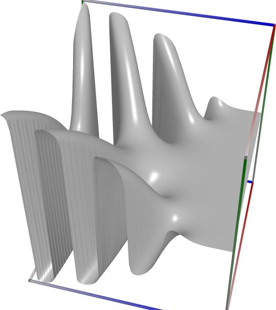

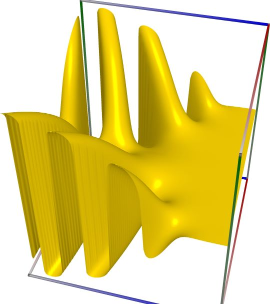

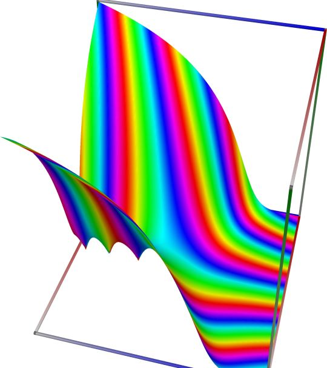

The corresponding scaled function looks like this:

|03a_TestAiryAie_re| `\quad` |03b_TestAiryAie_im| `\quad` |03c_TestAiryAie_abs|

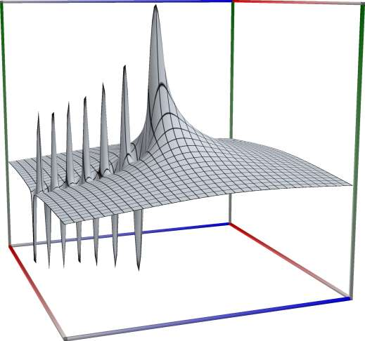

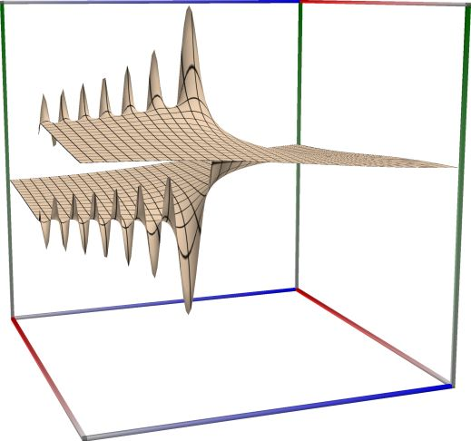

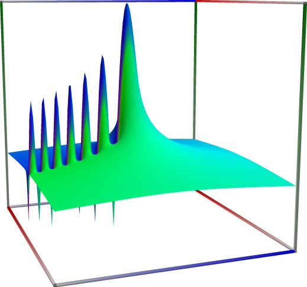

An example with real input:

.. code-block:: pycon

    >>> from xlcalcnet import *
    >>> x = -5.1; gui.setdps(90)
    >>> for ctx in gui.ctxlist_noipm_real: print(ctx.fmtname + ': ' + ctx.fmt(ctx.airy_ai(x, False)))
        fpm:  0.309525996287318
        mpm:  0.309525996287317515926441637912867279618536907067502464917867573048794204563419131365696389
        dpm:  0.309525996287317515926441637912867279618536907067502464917867573048794204563419131365696389
        gpm:  0.30952599628731751592644163791286727961853690706750246491786757304879420456341913136569638902
        apm: [0.30952599628731751592644163791286727961853690706750246491786757304879420456341913136569639 +/- 1.72e-90]
     math53:  0.309525996287318
      sreal:  0.3095261
      dreal:  0.309525996287318
      ereal:  0.30952599628731751602
      qreal:  0.309525996287317515926441637912868
      oreal:  0.30952599628731751592644163791286727961853690706750246491786757304879419
      mreal:  0.309525996287317515926441637912867279618536907067502464917867573048794204563419131365696387
     sflint:  0.3095261
     dflint:  0.309525996287318
     eflint:  0.30952599628731751596
     qflint:  0.309525996287317515926441637912867
     oflint:  0.3095259962873175159264416379128672796185369070675024649178675730487942
     mflint:  0.309525996287317515926441637912867279618536907067502464917867573048794204563419131365696389
     aflint: [0.30952599628731751592644163791286727961853690706750246491786757304879420456341913136569639 +/- 1.86e-90]

An example with complex input, using C\#-style formatting for complex numbers for the result 

.. code-block:: pycon

    >>> from xlcalcnet import *
    >>> x = -5.1+2j; gui.setdps(50)
    >>> for ctx in [fpm, mpm, cmath53]: print(ctx.fmtname + ': ' + ctx.fmt(ctx.airy_ai(x, False)))
        fpm:  (16.8581138906585, 4.43155979444773)
        mpm:  (16.858113890658462241375695157800428278271509309156, 4.4315597944477321679509467524967641122136696643146)
    cmath53:  (16.8581138906589, 4.43155979444783)

An example with the same complex input as above, showing only the real part of the result:

.. code-block:: pycon

    >>> from xlcalcnet import *
    >>> x = -5.1+2j; gui.setdps(90)
    >>> for ctx in gui.ctxlist_noboost_cplx: 
    ...     print(ctx.fmtname + ': ' +  ctx.realctx.fmt(ctx.real(ctx.airy_ai(x, False))))
        fpm:  16.8581138906585
        mpm:  16.8581138906584622413756951578004282782715093091559855354007834960088720499562953755454609
        dpm:  16.8581138906584622413756951578004282782715093091559855354007834960088720499562953755454609
        gpm:  16.858113890658462241375695157800428278271509309155985535400783496008872049956295375545460899
        apm: [16.8581138906584622413756951578004282782715093091559855354007834960088720499562953755454609 +/- 5.04e-89]
    cmath53:  16.8581138906589
    sflintc:  16.85811
    dflintc:  16.8581138906585
    eflintc:  16.858113890658462242
    qflintc:  16.8581138906584622413756951578004
    oflintc:  16.858113890658462241375695157800428278271509309155985535400783496008872
    mflintc:  16.8581138906584622413756951578004282782715093091559855354007834960088720499562953755454609
    aflintc: [16.8581138906584622413756951578004282782715093091559855354007834960088720499562953755454609 +/- 6.10e-89]

An example with the same complex input as above, showing only the imaginary part of the result:

.. code-block:: pycon

    >>> from xlcalcnet import *
    >>> x = -5.1+2j; gui.setdps(90)
    >>> for ctx in gui.ctxlist_noboost_cplx: 
    ...     print(ctx.fmtname + ': ' +  ctx.realctx.fmt(ctx.imag(ctx.airy_ai(x, False))))
        fpm:  4.43155979444773
        mpm:  4.43155979444773216795094675249676411221366966431476050549409668306621277883733769123034504
        dpm:  4.43155979444773216795094675249676411221366966431476050549409668306621277883733769123034504
        gpm:  4.4315597944477321679509467524967641122136696643147605054940966830662127788373376912303450399
        apm: [4.4315597944477321679509467524967641122136696643147605054940966830662127788373376912303450 +/- 4.74e-89]
    cmath53:  4.43155979444783
    sflintc:  4.431556
    dflintc:  4.43155979444773
    eflintc:  4.4315597944477321643
    qflintc:  4.43155979444773216795094675249675
    oflintc:  4.4315597944477321679509467524967641122136696643147605054940966830662128
    mflintc:  4.431559794447732167950946752496764112213669664314760505494096683066212778837337691230345
    aflintc: [4.4315597944477321679509467524967641122136696643147605054940966830662127788373376912303450 +/- 4.33e-89]

The above and additional examples can be found online in the ``DataXlCalcNet`` repository or in the corresponding local ``DataXlCalcNet`` folder for `Python (real input) <https://github.com/duhadler/DataXlCalcNet/blob/master/DataXlCalcNet/A01_ExamplesPython/B10_Hypergeometric0F1/C07_AiryFunctions/D01a_AiryAiReal.py>`__, `Python (complex input) <https://github.com/duhadler/DataXlCalcNet/blob/master/DataXlCalcNet/A01_ExamplesPython/B10_Hypergeometric0F1/C07_AiryFunctions/D01b_AiryAiCplx.py>`__, and `C\# (real or complex input) <https://github.com/duhadler/DataXlCalcNet/blob/master/DataXlCalcNet/A02_ExamplesCSharp/B10_Hypergeometric0F1/C07_AiryFunctions/D01_AiryAi.cs>`__. 

|newpage|

Airy function `\mathrm{Bi}(x)`
-------------------------------------------------------------------------------

.. method:: ctx.airy_bi(x, scaled=False)

    where ``ctx`` is ``math53``, ``ctxboost`` or ``ctxflint``.

    Returns the Airy function `\mathrm{Bi}(x)`, with `x \in \mathbb{C}`. 

    If *scaled* is *True*, then `\mathrm{Bi}(x) \exp(-|\Re (\sqrt{x} \cdot 2x/3)|)` is returned, except for a real ``ctx`` with `x \le 0` where just `\mathrm{Bi}(x)` is returned.  
    
    See also Wikipedia :cite:p:`WikipediaFun146`, MathWorld :cite:p:`WolframFun146`, MathWorld :cite:p:`WolframFun146b`, NIST :cite:p:`DLMFun146`, BoostMath :cite:p:`BoostFun146b`, :cite:t:`Ehrhardt2018` (3.1.7.2), Mpmath :cite:p:`MpmathFun146b`.

    The function `\mathrm{Bi}(x)` can be defined as

    .. math::  \mathrm{Bi}(x) = \frac{1}{3^{1/6}\Gamma(2/3)} {}_0F_1\left(\frac{2}{3},\frac{x^3}{9}\right) + \frac{3^{1/6} x}{\Gamma(1/3)} {}_0F_1\left(\frac{4}{3},\frac{x^3}{9}\right).

    The :ref:`wpf figures <rst_wpf_complex_function>` below are showing the real part (left figure), imaginary part (middle figure) and absolute value with color-coded phase (right figure) of the complex function `z = \mathrm{Bi}(x + iy)` with `-6 \le x \le 6` (blue axis), `-6 \le y \le 6` (red axis), `-10 \le z \le 10` (green axis). Function values are :ref:`loglog-transformed <rst_mpm_loglog_transformation>`. 

|04a_TestAiryBi_re| `\quad` |04b_TestAiryBi_im| `\quad` |04c_TestAiryBi_abs|

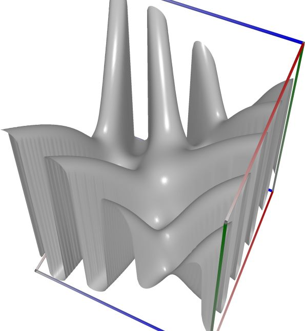

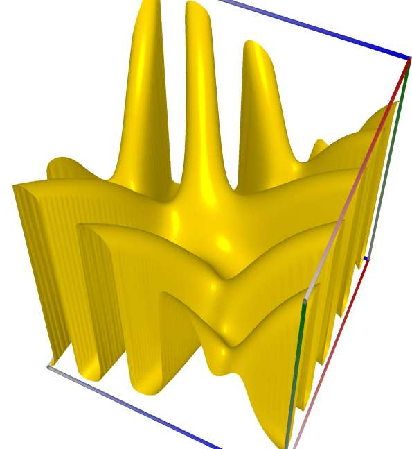

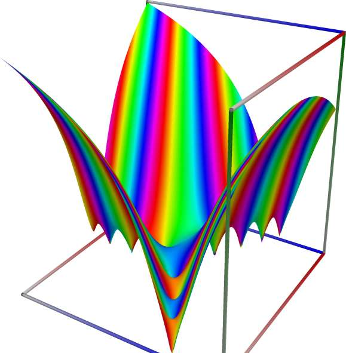

The corresponding scaled function looks like this:

|05a_TestAiryBie_re| `\quad` |05b_TestAiryBie_im| `\quad` |05c_TestAiryBie_abs|

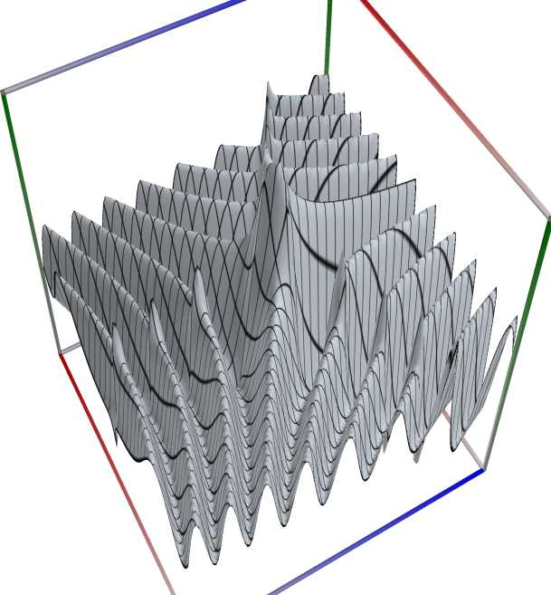

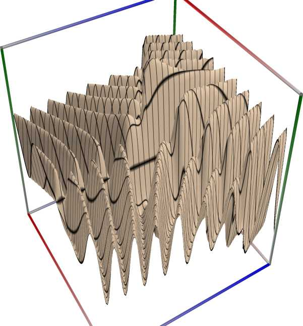

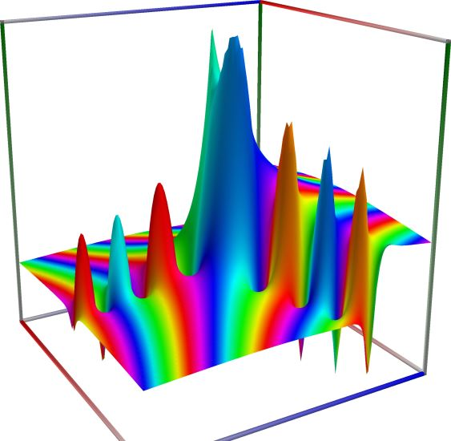

An example with real input:

.. code-block:: pycon

    >>> from xlcalcnet import *
    >>> x = -5.1; gui.setdps(90)
    >>> for ctx in gui.ctxlist_noipm_real: print(ctx.fmtname + ': ' + ctx.fmt(ctx.airy_bi(x, False)))
        fpm:  -0.212089131569036
        mpm:  -0.212089131569036475928306202379900373569552239703617385974478140824105835666719462789606753
        dpm:  -0.212089131569036475928306202379900373569552239703617385974478140824105835666719462789606753
        gpm:  -0.21208913156903647592830620237990037356955223970361738597447814082410583566671946278960675299
        apm: [-0.212089131569036230973981494925658905281172114972911923074667269235437374594668416972611652 +/- 5.05e-91]
     math53:  -0.212089131569036
      sreal:  -0.2120891
      dreal:  -0.212089131569036
      ereal:  -0.21208913156903647593
      qreal:  -0.2120891315690364759283062023799
      oreal:  -0.21208913156903647592830620237990037356955223970361738597447814082410591
      mreal:  -0.212089131569036475928306202379900373569552239703617385974478140824105835666719462789606752
     sflint:  -0.2120891
     dflint:  -0.212089131569036
     eflint:  -0.21208913156903647586
     qflint:  -0.2120891315690364759283062023799
     oflint:  -0.21208913156903647592830620237990037356955223970361738597447814082410584
     mflint:  -0.212089131569036475928306202379900373569552239703617385974478140824105835666719462789606752
     aflint: [-0.21208913156903647592830620237990037356955223970361738597447814082410583566671946278960675 +/- 3.16e-90]

An example with complex input, using C\#-style formatting for complex numbers for the result 

.. code-block:: pycon

    >>> from xlcalcnet import *
    >>> x = -5.1+2j; gui.setdps(50)
    >>> for ctx in [fpm, mpm, cmath53]: print(ctx.fmtname + ': ' + ctx.fmt(ctx.airy_bi(x, False)))
        fpm:  (-4.43183672531321, 16.8542238974576)
        mpm:  (-4.4318367253132124667194605513834287595872525671955, 16.854223897457646435868836513338759689607829395087)
    cmath53:  (-4.43183672531358, 16.8542238974578)

An example with the same complex input as above, showing only the real part of the result:

.. code-block:: pycon

    >>> from xlcalcnet import *
    >>> x = -5.1+2j; gui.setdps(90)
    >>> for ctx in gui.ctxlist_noboost_cplx: 
    ...     print(ctx.fmtname + ': ' +  ctx.realctx.fmt(ctx.real(ctx.airy_bi(x, False))))
        fpm:  -4.43183672531321
        mpm:  -4.43183672531321246671946055138342875958725256719562861787164629998380751732480724217937896
        dpm:  -4.43183672531321246671946055138342875958725256719562861787164629998380751732480724217937896
        gpm:  -4.4318367253132124667194605513834287595872525671956286178716462999838075173248072421793789599
        apm: [-4.43183672531319816799161866457413056035670213647536795617262048847344599957424969506442475 +/- 5.12e-90]
    cmath53:  -4.43183672531358
    sflintc:  -4.431833
    dflintc:  -4.43183672531321
    eflintc:  -4.4318367253132124632
    qflintc:  -4.43183672531321246671946055138342
    oflintc:  -4.4318367253132124667194605513834287595872525671956286178716462999838075
    mflintc:  -4.43183672531321246671946055138342875958725256719562861787164629998380751732480724217937892
    aflintc: [-4.4318367253132124667194605513834287595872525671956286178716462999838075173248072421793789 +/- 5.87e-89]

An example with the same complex input as above, showing only the imaginary part of the result:

.. code-block:: pycon

    >>> from xlcalcnet import *
    >>> x = -5.1+2j; gui.setdps(90)
    >>> for ctx in gui.ctxlist_noboost_cplx: 
    ...     print(ctx.fmtname + ': ' +  ctx.realctx.fmt(ctx.imag(ctx.airy_bi(x, False))))
        fpm:  16.8542238974576
        mpm:  16.8542238974576464358688365133387596896078293950869494365777785351494783931968243140926506
        dpm:  16.8542238974576464358688365133387596896078293950869494365777785351494783931968243140926506
        gpm:  16.854223897457646435868836513338759689607829395086949436577778535149478393196824314092650602
        apm: [16.8542238974576476934260923872204552973297781005541843068145555670897743025109944672921153 +/- 1.38e-89]
    cmath53:  16.8542238974578
    sflintc:  16.85423
    dflintc:  16.8542238974576
    eflintc:  16.854223897457646436
    qflintc:  16.8542238974576464358688365133388
    oflintc:  16.854223897457646435868836513338759689607829395086949436577778535149478
    mflintc:  16.8542238974576464358688365133387596896078293950869494365777785351494783931968243140926506
    aflintc: [16.8542238974576464358688365133387596896078293950869494365777785351494783931968243140926506 +/- 8.93e-89]

The above and additional examples can be found online in the ``DataXlCalcNet`` repository or in the corresponding local ``DataXlCalcNet`` folder for `Python (real input) <https://github.com/duhadler/DataXlCalcNet/blob/master/DataXlCalcNet/A01_ExamplesPython/B10_Hypergeometric0F1/C07_AiryFunctions/D02a_AiryBiReal.py>`__, `Python (complex input) <https://github.com/duhadler/DataXlCalcNet/blob/master/DataXlCalcNet/A01_ExamplesPython/B10_Hypergeometric0F1/C07_AiryFunctions/D02b_AiryBiCplx.py>`__, and `C\# (real or complex input) <https://github.com/duhadler/DataXlCalcNet/blob/master/DataXlCalcNet/A02_ExamplesCSharp/B10_Hypergeometric0F1/C07_AiryFunctions/D02_AiryBi.cs>`__. 

|newpage|

First derivative of the Airy function `\mathrm{Ai}`, `\mathrm{Ai}'(x)`
------------------------------------------------------------------------------------------------------

.. method:: ctx.airy_ai_prime(x, scaled=False)

    where ``ctx`` is ``math53``, ``ctxboost`` or ``ctxflint``.

    Returns `\mathrm{Ai}'(x)`, the first derivative (with respect to `x`) of the  Airy function `\mathrm{Ai}(x)`, with `x \in \mathbb{C}`.

    If *scaled* is *True*, then `\mathrm{Ai}'(x) \exp(\sqrt{x} \cdot 2x/3)` is returned, except for a real ``ctx`` with `x \le 0` where just `\mathrm{Ai}'(x)` is returned.  

    See also Wikipedia :cite:p:`WikipediaFun146`, MathWorld :cite:p:`WolframFun146`, MathWorld :cite:p:`WolframFun146c`, NIST :cite:p:`DLMFun146`, BoostMath :cite:p:`BoostFun146c`, :cite:t:`Ehrhardt2018` (3.1.7.3). 

    The function `\mathrm{Ai}'(x)` can be defined as

    .. math::  \mathrm{Ai}'(x) = \frac{x^2}{2 \cdot 3^{2/3}\Gamma(2/3)} {}_0F_1\left(\frac{5}{3},\frac{x^3}{9}\right) - \frac{1}{3^{1/3}\Gamma(1/3)} {}_0F_1\left(\frac{1}{3},\frac{x^3}{9}\right).

    The :ref:`wpf figures <rst_wpf_complex_function>` below are showing the real part (left figure), imaginary part (middle figure) and absolute value with color-coded phase (right figure) of the complex function `z = \mathrm{Ai}'(x + iy)` with `\nu=0` and  `-6 \le x \le 6` (blue axis), `-6 \le y \le 6` (red axis), `-10 \le z \le 10` (green axis). Function values are :ref:`loglog-transformed <rst_mpm_loglog_transformation>`.

An example with real input:

.. code-block:: pycon

    >>> from xlcalcnet import *
    >>> x = -5.1; gui.setdps(90)
    >>> for ctx in gui.ctxlist_noipm_real: print(ctx.fmtname + ': ' + ctx.fmt(ctx.airy_ai_prime(x, False)))
        fpm:  0.494585998384937
        mpm:  0.494585998384937055094775683140363130115424233969553419883341510769611820797731719896172805
        dpm:  0.494585998384937055094775683140363130115424233969553419883341510769611820797731719896172805
        gpm:  0.494585998384937055094775683140363130115424233969553419883341510769611820797731719896172805
        apm: [0.49458599838493705509477568314036313011542423396955341988334151076961182079773171989617280 +/- 4.94e-90]
     math53:  0.494585998384936
      sreal:  0.4945858
      dreal:  0.494585998384936
      ereal:  0.49458599838493705496
      qreal:  0.494585998384937055094775683140363
      oreal:  0.49458599838493705509477568314036313011542423396955341988334151076961172
      mreal:  0.494585998384937055094775683140363130115424233969553419883341510769611820797731719896172803
     sflint:  0.4945858
     dflint:  0.494585998384937
     eflint:  0.49458599838493705496
     qflint:  0.494585998384937055094775683140363
     oflint:  0.49458599838493705509477568314036313011542423396955341988334151076961182
     mflint:  0.494585998384937055094775683140363130115424233969553419883341510769611820797731719896172803
     aflint: [0.49458599838493705509477568314036313011542423396955341988334151076961182079773171989617280 +/- 4.67e-90]

An example with complex input, using C\#-style formatting for complex numbers for the result 

.. code-block:: pycon

    >>> from xlcalcnet import *
    >>> x = -5.1+2j; gui.setdps(50)
    >>> for ctx in [fpm, mpm, cmath53]: print(ctx.fmtname + ': ' + ctx.fmt(ctx.airy_ai_prime(x, False)))
        fpm:  (3.54220060327507, -40.2384573129308)
        mpm:  (3.5422006032750699652802348649820267087570281099911, -40.238457312930775705134764371795953522441544602208)
    cmath53:  (3.54220060327503, -40.2384573129308)

An example with the same complex input as above, showing only the real part of the result:

.. code-block:: pycon

    >>> from xlcalcnet import *
    >>> x = -5.1+2j; gui.setdps(90)
    >>> for ctx in gui.ctxlist_noboost_cplx: 
    ...     print(ctx.fmtname + ': ' +  ctx.realctx.fmt(ctx.real(ctx.airy_ai_prime(x, False))))
        fpm:  3.54220060327507
        mpm:  3.54220060327506996528023486498202670875702810999147303521632850684728585634972349995733918
        dpm:  3.54220060327506996528023486498202670875702810999147303521632850684728585634972349995733918
        gpm:  3.54220060327506996528023486498202670875702810999147303521632850684728585634972349995733918
        apm: [3.542200603275069965280234864982026708757028109991473035216328506847285856349723499957339 +/- 1.95e-88]
    cmath53:  3.54220060327503
    sflintc:  3.542192
    dflintc:  3.54220060327507
    eflintc:  3.542200603275069957
    qflintc:  3.542200603275069965280234864982
    oflintc:  3.5422006032750699652802348649820267087570281099914730352163285068472859
    mflintc:  3.54220060327506996528023486498202670875702810999147303521632850684728585634972349995733909
    aflintc: [3.542200603275069965280234864982026708757028109991473035216328506847285856349723499957339 +/- 1.74e-88]

An example with the same complex input as above, showing only the imaginary part of the result:

.. code-block:: pycon

    >>> from xlcalcnet import *
    >>> x = -5.1+2j; gui.setdps(90)
    >>> for ctx in gui.ctxlist_noboost_cplx: 
    ...     print(ctx.fmtname + ': ' +  ctx.realctx.fmt(ctx.imag(ctx.airy_ai_prime(x, False))))
        fpm:  -40.2384573129308
        mpm:  -40.2384573129307757051347643717959535224415446022084526696646395828571751860710216054095167
        dpm:  -40.2384573129307757051347643717959535224415446022084526696646395828571751860710216054095167
        gpm:  -40.238457312930775705134764371795953522441544602208452669664639582857175186071021605409516699
        apm: [-40.238457312930775705134764371795953522441544602208452669664639582857175186071021605409517 +/- 4.78e-88]
    cmath53:  -40.2384573129308
    sflintc:  -40.23846
    dflintc:  -40.2384573129308
    eflintc:  -40.238457312930775704
    qflintc:  -40.238457312930775705134764371796
    oflintc:  -40.238457312930775705134764371795953522441544602208452669664639582857175
    mflintc:  -40.2384573129307757051347643717959535224415446022084526696646395828571751860710216054095166
    aflintc: [-40.238457312930775705134764371795953522441544602208452669664639582857175186071021605409517 +/- 4.88e-88]

The above and additional examples can be found online in the ``DataXlCalcNet`` repository or in the corresponding local ``DataXlCalcNet`` folder for `Python (real input) <https://github.com/duhadler/DataXlCalcNet/blob/master/DataXlCalcNet/A01_ExamplesPython/B10_Hypergeometric0F1/C07_AiryFunctions/D03a_AiryAiRealPrime.py>`__, `Python (complex input) <https://github.com/duhadler/DataXlCalcNet/blob/master/DataXlCalcNet/A01_ExamplesPython/B10_Hypergeometric0F1/C07_AiryFunctions/D03b_AiryAiCplxPrime.py>`__, and `C\# (real or complex input) <https://github.com/duhadler/DataXlCalcNet/blob/master/DataXlCalcNet/A02_ExamplesCSharp/B10_Hypergeometric0F1/C07_AiryFunctions/D03_AiryAiPrime.cs>`__. 

|newpage|

First derivative of the Airy function `\mathrm{Bi}`, `\mathrm{Bi}'(x)`
-----------------------------------------------------------------------------------------------------

.. method:: ctx.airy_bi_prime(x, scaled=False)

    where ``ctx`` is ``math53``, ``ctxboost`` or ``ctxflint``.
    
    Returns `\mathrm{Bi}'(x)`, the first derivative (with respect to `x`) of the  Airy function `\mathrm{Bi}(x)`, with `x \in \mathbb{C}`.
    
    If *scaled* is *True*, then `\mathrm{Bi}'(x) \exp(-|\Re (\sqrt{x} \cdot 2x/3)|)` is returned, except for a real ``ctx`` with `x \le 0` where just `\mathrm{Bi}'(x)` is returned.  

    See also Wikipedia :cite:p:`WikipediaFun146`, MathWorld :cite:p:`WolframFun146`, MathWorld :cite:p:`WolframFun146d`, NIST :cite:p:`DLMFun146`, BoostMath :cite:p:`BoostFun146d`, :cite:t:`Ehrhardt2018` (3.1.7.4) and  (3.1.7.6). 

    The function can be defined as

    .. math::  \mathrm{Bi}'(x) = \frac{x^2}{2 \cdot 3^{1/6}\Gamma(2/3)} {}_0F_1\left(\frac{5}{3},\frac{x^3}{9}\right) + \frac{3^{1/6}}{\Gamma(1/3)} {}_0F_1\left(\frac{1}{3},\frac{x^3}{9}\right).

    The :ref:`wpf figures <rst_wpf_complex_function>` below are showing the real part (left figure), imaginary part (middle figure) and absolute value with color-coded phase (right figure) of the complex function `z = \mathrm{Bi}'(x + iy)` with `\nu=0` and  `-6 \le x \le 6` (blue axis), `-6 \le y \le 6` (red axis), `-10 \le z \le 10` (green axis). Function values are :ref:`loglog-transformed <rst_mpm_loglog_transformation>`.

An example with real input:

.. code-block:: pycon

    >>> from xlcalcnet import *
    >>> x = -5.1; gui.setdps(90)
    >>> for ctx in gui.ctxlist_noipm_real: print(ctx.fmtname + ': ' + ctx.fmt(ctx.airy_bi_prime(x, False)))
        fpm:  0.689485128422051
        mpm:  0.689485128422051310036403273005898186107345862604943742464082478820383090454987687810927913
        dpm:  0.689485128422051310036403273005898186107345862604943742464082478820383090454987687810927913
        gpm:  0.689485128422051310036403273005898186107345862604943742464082478820383090454987687810927913
        apm: [0.68948512842205131003640327300589818610734586260494374246408247882038309045498768781092791 +/- 5.94e-90]
     math53:  0.689485128422052
      sreal:  0.6894853
      dreal:  0.689485128422052
      ereal:  0.68948512842205130977
      qreal:  0.689485128422051310036403273005898
      oreal:  0.68948512842205131003640327300589818610734586260494374246408247882038309
      mreal:  0.689485128422051310036403273005898186107345862604943742464082478820383090454987687810927917
     sflint:  0.6894853
     dflint:  0.689485128422051
     eflint:  0.68948512842205131015
     qflint:  0.689485128422051310036403273005899
     oflint:  0.68948512842205131003640327300589818610734586260494374246408247882038309
     mflint:  0.689485128422051310036403273005898186107345862604943742464082478820383090454987687810927914
     aflint: [0.68948512842205131003640327300589818610734586260494374246408247882038309045498768781092791 +/- 5.55e-90]

An example with complex input, using C\#-style formatting for complex numbers for the result 

.. code-block:: pycon

    >>> from xlcalcnet import *
    >>> x = -5.1+2j; gui.setdps(90)
    >>> for ctx in [fpm, mpm, cmath53]: print(ctx.fmtname + ': ' + ctx.fmt(ctx.airy_bi_prime(x, False)))
        fpm:  (40.247340862871, 3.53970899309419)
        mpm:  (40.247340862870983724147380877811616482391458925857, 3.5397089930941900287371221814069208297531937210087)
    cmath53:  (40.2473408628714, 3.53970899309498)

An example with the same complex input as above, showing only the real part of the result:

.. code-block:: pycon

    >>> from xlcalcnet import *
    >>> x = -5.1+2j; gui.setdps(90)
    >>> for ctx in gui.ctxlist_noboost_cplx: 
    ...     print(ctx.fmtname + ': ' +  ctx.realctx.fmt(ctx.real(ctx.airy_bi_prime(x, False))))
        fpm:  40.247340862871
        mpm:  40.2473408628709837241473808778116164823914589258567703091703828529749799597616989562100266
        dpm:  40.2473408628709837241473808778116164823914589258567703091703828529749799597616989562100266
        gpm:  40.247340862870983724147380877811616482391458925856770309170382852974979959761698956210026597
        apm: [40.247340862870983724147380877811616482391458925856770309170382852974979959761698956210027 +/- 5.64e-88]
    cmath53:  40.2473408628714
    sflintc:  40.24734
    dflintc:  40.247340862871
    eflintc:  40.247340862870983724
    qflintc:  40.2473408628709837241473808778116
    oflintc:  40.24734086287098372414738087781161648239145892585677030917038285297498
    mflintc:  40.2473408628709837241473808778116164823914589258567703091703828529749799597616989562100265
    aflintc: [40.247340862870983724147380877811616482391458925856770309170382852974979959761698956210027 +/- 5.90e-88]

An example with the same complex input as above, showing only the imaginary part of the result:

.. code-block:: pycon

    >>> from xlcalcnet import *
    >>> x = -5.1+2j; gui.setdps(90)
    >>> for ctx in gui.ctxlist_noboost_cplx: 
    ...     print(ctx.fmtname + ': ' +  ctx.realctx.fmt(ctx.imag(ctx.airy_bi_prime(x, False))))
        fpm:  3.53970899309419
        mpm:  3.53970899309419002873712218140692082975319372100906354626332766128111876343721387448880857
        dpm:  3.53970899309419002873712218140692082975319372100906354626332766128111876343721387448880857
        gpm:  3.5397089930941900287371221814069208297531937210090635462633276612811187634372138744888085701
        apm: [3.539708993094190028737122181406920829753193721009063546263327661281118763437213874488808 +/- 5.83e-88]
    cmath53:  3.53970899309497
    sflintc:  3.5397
    dflintc:  3.53970899309419
    eflintc:  3.5397089930941900205
    qflintc:  3.53970899309419002873712218140689
    oflintc:  3.5397089930941900287371221814069208297531937210090635462633276612811188
    mflintc:  3.53970899309419002873712218140692082975319372100906354626332766128111876343721387448880848
    aflintc: [3.539708993094190028737122181406920829753193721009063546263327661281118763437213874488808 +/- 5.63e-88]

The above and additional examples can be found online in the ``DataXlCalcNet`` repository or in the corresponding local ``DataXlCalcNet`` folder for `Python (real input) <https://github.com/duhadler/DataXlCalcNet/blob/master/DataXlCalcNet/A01_ExamplesPython/B10_Hypergeometric0F1/C07_AiryFunctions/D04a_AiryBiRealPrime.py>`__, `Python (complex input) <https://github.com/duhadler/DataXlCalcNet/blob/master/DataXlCalcNet/A01_ExamplesPython/B10_Hypergeometric0F1/C07_AiryFunctions/D04b_AiryBiCplxPrime.py>`__, and `C\# (real or complex input) <https://github.com/duhadler/DataXlCalcNet/blob/master/DataXlCalcNet/A02_ExamplesCSharp/B10_Hypergeometric0F1/C07_AiryFunctions/D04_AiryBiPrime.cs>`__. 

|newpage|

Real zeros `a_k` of the Airy function `\mathrm{Ai}`, `\mathrm{Ai}(a_k)=0`
-------------------------------------------------------------------------------------------

.. method:: ctx.airy_ai_zero(k)

    where ``ctx`` is ``math53``, ``ctxboost`` or ``ctxflint``.

    Returns the `k`-th zero of the Airy Ai-function.  See also MathWorld :cite:p:`WolframFun147a`, NIST :cite:p:`DLMFun146`, BoostMath :cite:p:`BoostFun146b`, BoostMath :cite:p:`BoostFun146d`, Mpmath :cite:p:`MpmathFun146c`.

An example:

.. code-block:: pycon

    >>> from xlcalcnet import *
    >>> m = 5; gui.setdps(90)
    >>> for ctx in gui.ctxlist_noipm_real: print(ctx.fmtname + ': ' + ctx.fmt(ctx.airy_ai_zero(m)))
        fpm:  -7.94413358712085
        mpm:  -7.94413358712085312313828055579826853214067439697221480864385428571644864029567410699281848
        dpm:  -7.94413358712085312313828055579826853214067439697221480864385428571644864029567410699281848
        gpm:  -7.9441335871208531231382805557982685321406743969722148086438542857164486402956741069928184796
        apm: [-7.94413358712085312313828055579826853214067439697221480864385428571644864029567410699281847 +/- 5.66e-90]
     math53:  -7.94413358712085
      sreal:  -7.944134
      dreal:  -7.94413358712085
      ereal:  -7.9441335871208531229
      qreal:  -7.94413358712085312313828055579827
      oreal:  -7.9441335871208531231382805557982685321406743969722148086438542857164486
      mreal:  -7.94413358712085312313828055579826853214067439697221480864385428571644864029567410699281848
     sflint:  -7.944134
     dflint:  -7.94413358712085
     eflint:  -7.9441335871208531233
     qflint:  -7.94413358712085312313828055579827
     oflint:  -7.9441335871208531231382805557982685321406743969722148086438542857164486
     mflint:  -7.94413358712085312313828055579826853214067439697221480864385428571644864029567410699281847
     aflint: [-7.94413358712085312313828055579826853214067439697221480864385428571644864029567410699281847 +/- 7.63e-90]

The above and additional examples can be found online in the ``DataXlCalcNet`` repository or in the corresponding local ``DataXlCalcNet`` folder for `Python (real input) <https://github.com/duhadler/DataXlCalcNet/blob/master/DataXlCalcNet/A01_ExamplesPython/B10_Hypergeometric0F1/C07_AiryFunctions/D05a_AiryAiZero.py>`__, and `C\# (real or complex input) <https://github.com/duhadler/DataXlCalcNet/blob/master/DataXlCalcNet/A02_ExamplesCSharp/B10_Hypergeometric0F1/C07_AiryFunctions/D05_AiryAiZero.cs>`__. 

|newpage|

Real zeros `b_k` of the Airy function `\mathrm{Bi}`, `\mathrm{Bi}(b_k)=0`
-------------------------------------------------------------------------------------------

.. method:: ctx.airy_bi_zero(k)

    where ``ctx`` is ``math53``, ``ctxboost`` or ``ctxflint``.

    Returns the `k`-th zero of the Airy Bi-function. See also Wikipedia :cite:p:`WikipediaFun146`, NIST :cite:p:`DLMFun146`, MathWorld :cite:p:`WolframFun147b`, BoostMath :cite:p:`BoostFun147`, Mpmath :cite:p:`MpmathFun147`.  

An example:

.. code-block:: pycon

    >>> from xlcalcnet import *
    >>> m = 5; gui.setdps(90)
    >>> for ctx in gui.ctxlist_noipm_real: print(ctx.fmtname + ': ' + ctx.fmt(ctx.airy_bi_zero(m)))
        fpm:  -7.37676207936776
        mpm:  -7.37676207936776371359995933044254122209152229939709572992390169564233479258314147743918848
        dpm:  -7.37676207936776371359995933044254122209152229939709572992390169564233479258314147743918848
        gpm:  -7.3767620793677637135999593304425412220915222993970957299239016956423347925831414774391884796
        apm: [-7.37676207936776371359995933044254122209152229939709572992390169564233479258314147743918848 +/- 2.36e-90]
     math53:  -7.37676207936776
      sreal:  -7.376762
      dreal:  -7.37676207936776
      ereal:  -7.3767620793677637133
      qreal:  -7.37676207936776371359995933044254
      oreal:  -7.3767620793677637135999593304425412220915222993970957299239016956423348
      mreal:  -7.37676207936776371359995933044254122209152229939709572992390169564233479258314147743918848
     sflint:  -7.376762
     dflint:  -7.37676207936776
     eflint:  -7.3767620793677637137
     qflint:  -7.37676207936776371359995933044254
     oflint:  -7.3767620793677637135999593304425412220915222993970957299239016956423348
     mflint:  -7.37676207936776371359995933044254122209152229939709572992390169564233479258314147743918848
     aflint: [-7.37676207936776371359995933044254122209152229939709572992390169564233479258314147743918848 +/- 7.28e-90]

The above and additional examples can be found online in the ``DataXlCalcNet`` repository or in the corresponding local ``DataXlCalcNet`` folder for `Python (real input) <https://github.com/duhadler/DataXlCalcNet/blob/master/DataXlCalcNet/A01_ExamplesPython/B10_Hypergeometric0F1/C07_AiryFunctions/D06a_AiryBiZero.py>`__, and `C\# (real or complex input) <https://github.com/duhadler/DataXlCalcNet/blob/master/DataXlCalcNet/A02_ExamplesCSharp/B10_Hypergeometric0F1/C07_AiryFunctions/D06_AiryBiZero.cs>`__. 

